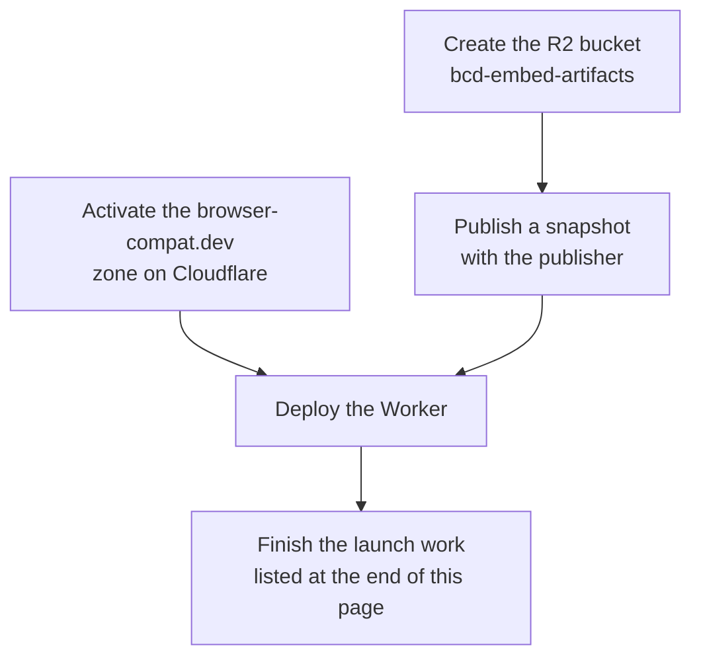
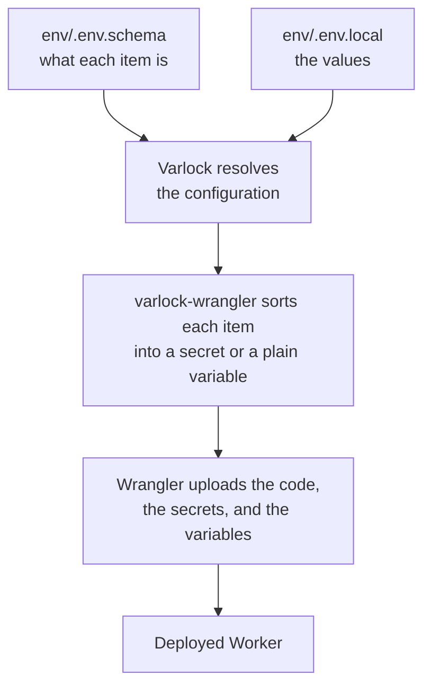

The Worker is the program on Cloudflare's network that answers API requests by
reading files from an R2 bucket. This page explains what has to be in place
before you deploy it, how its configuration reaches Cloudflare, and what one
deploy changes. For where the Worker sits in the whole pipeline, see
[How bcd-embed works](/).

The Worker's code is in
[`apps/worker`](https://github.com/schalkneethling/bcd-embed/tree/main/apps/worker).
Its [README](https://github.com/schalkneethling/bcd-embed/blob/main/apps/worker/README.md)
describes how it caches, negotiates compression, and reports errors. The last
sections cover [deploying this documentation site](#deploying-the-documentation-site),
which is a separate Cloudflare deploy with its own commands.

## What must exist before a deploy

A deployed Worker with nothing to read can only return errors, so the order
matters.



The bucket name `bcd-embed-artifacts` is set in `apps/worker/wrangler.jsonc`.
The bucket is a deployment prerequisite, not something this repository
creates: no command here provisions a bucket or uploads objects as part of a
deploy.

An operator creates the bucket and then publishes a snapshot with
`@bcd-embed/publisher`, which uploads the immutable objects a snapshot needs
and writes `v1/meta.json` last. [How publication works](/publication/) describes
that process. Do not deploy against an empty bucket, and do not assume the
metadata the generator writes to disk is already a safe remote publication.

## Where the Worker answers

The Worker answers only on `https://api.browser-compat.dev`, a Workers Custom
Domain. Three fields in `apps/worker/wrangler.jsonc` set this up:

| Field                 | What it does                                                                                                                                        |
| --------------------- | --------------------------------------------------------------------------------------------------------------------------------------------------- |
| `routes`              | Attaches the Worker to `api.browser-compat.dev`. On deploy, Cloudflare creates the DNS record and a certificate for that hostname.                  |
| `workers_dev: false`  | Removes the `workers.dev` address. Turning it off only in the dashboard does not last, because the next Wrangler deploy turns it back on.           |
| `preview_urls: false` | Turns off preview and version addresses. Turning off `workers.dev` leaves these on, and they would let clients reach the Worker around rate limits. |

The `browser-compat.dev` zone must be active on Cloudflare before a deploy,
because a Custom Domain can only be created on an active zone. The zone must
have no DNS record of its own for `api.browser-compat.dev`, since Cloudflare
creates that record. Why the API moved off `workers.dev` is explained in
[Document 9](https://github.com/schalkneethling/bcd-embed/blob/main/docs/planning/09-custom-domain-and-rate-limits.md).

## Rate limiting

One Cloudflare rate limiting rule protects the API. It belongs to the
`browser-compat.dev` zone, not to this repository, so it is created in the
Cloudflare dashboard. A deploy does not change it. These are its settings:

| Setting    | Value                       |
| ---------- | --------------------------- |
| Match      | URI path starts with `/v1/` |
| Counted by | IP address                  |
| Requests   | 300                         |
| Period     | 10 seconds                  |
| Action     | Block                       |
| Duration   | 10 seconds                  |

A blocked request gets Cloudflare's own HTML `429` page, and the Worker never
runs, so it does not count as a Workers request. The page has no CORS header,
so a browser reports a blocked request to the component as a network error.
[Document 9](https://github.com/schalkneethling/bcd-embed/blob/main/docs/planning/09-custom-domain-and-rate-limits.md)
explains why the zone's plan fixes most of these settings, and records the
test that tripped the rule.

## How configuration reaches the Worker

The Worker has one configuration value today: `SENTRY_DSN`, the address that
runtime errors are reported to. It is optional. Without it the Worker runs with
Sentry, the error-reporting service, turned off.

[Varlock](https://varlock.dev) manages that value. Varlock is a tool that reads
a schema describing each configuration item, finds the value for it, and
checks the two against each other.

```
apps/worker/
├─ wrangler.jsonc        Wrangler's configuration: Worker name, bucket binding
├─ package.json          points Varlock at env/ with the varlock.loadPath setting
└─ env/
   ├─ .env.schema        the schema; the only Varlock file in git
   └─ .env.local         the values; git-ignored, encrypted for this machine
```

Varlock's files are in `env/`, not beside `wrangler.jsonc`, for a specific
reason. Wrangler reads a `.env.local` that sits next to its configuration and
adds the keys to the types it generates. `worker-configuration.d.ts` would then
differ between a machine that has the DSN and CI, which does not, and the
type check would fail on the first.

### Setting the Sentry DSN

1. Add this line to `apps/worker/env/.env.local`:

   ```
   SENTRY_DSN=varlock(prompt)
   ```

2. Load the configuration:

   ```sh
   pnpm --filter @bcd-embed/worker exec varlock load
   ```

Varlock asks for the value, encrypts it for this machine, and writes the
encrypted form back to the file. The same command prints the resolved
configuration with secrets masked, so you can run it again to check the result.

### Sentry alerting

Errors go to the `bcd-embed` project in the `schalkneethling` Sentry
organization, which stores its data in the EU region. The deployed Worker and
the freshness workflows' failure jobs both report to it with the same DSN. The
workflows read it from the repository secret `SENTRY_DSN`, because their
`notify-failure` jobs run without a GitHub environment.

Three settings in Sentry belong to this setup, not to this repository:

| Setting                                              | Why                                                                                                    |
| ---------------------------------------------------- | ------------------------------------------------------------------------------------------------------ |
| Scrub IP addresses: on                               | Sentry otherwise records the IP address each event was sent from, which the Worker never sends itself. |
| Alert "bcd-embed: email on every new issue"          | Emails the maintainer when Sentry creates a new issue, for both Worker errors and pipeline failures.   |
| Alert "Send a notification for high priority issues" | Sentry's default for a new project. It is left as created.                                             |

Worker events carry the tags `component: worker` and
`event: bcd_embed_worker_error`. Pipeline events have the title
`Pipeline <event> <status>`, the logger `bcd-embed.pipeline`, and the tags
`event` and `status`. To test the pipeline path without a workflow run:

```sh
SENTRY_DSN='<dsn>' node scripts/notify-sentry.mjs setup_check failure
```

Each new `<event>` and `<status>` pair creates a new issue, so the alert emails
once per pair.

## Running a deploy

```sh
pnpm --filter @bcd-embed/worker run deploy
```

That script runs `varlock-wrangler deploy`. `varlock-wrangler` comes from
`@varlock/cloudflare-integration` and wraps Wrangler, Cloudflare's
command-line tool.



`varlock-wrangler` decides how each item reaches Cloudflare from what the
schema says about it:

| Item                                | What it becomes         |
| ----------------------------------- | ----------------------- |
| Marked `@sensitive` in the schema   | A Worker secret         |
| Any other item in the schema        | A plain Worker variable |
| `__VARLOCK_ENV`, which Varlock adds | A Worker secret         |

`SENTRY_DSN` is marked `@sensitive`, so it is a secret.

`__VARLOCK_ENV` is one extra secret that `varlock-wrangler` always uploads. It
holds the resolved configuration for Varlock's optional runtime helper. The
Worker does not read it.

### A deploy replaces the Worker's variables

`varlock-wrangler` passes `--keep-vars=false` to Wrangler, which means each
deploy replaces the Worker's variables with the ones in the schema. A variable
added in the Cloudflare dashboard is removed by the next deploy. Add new
variables to `env/.env.schema` instead.

### Rolling a deploy back

To return to an earlier Worker version, list the recent deployments and roll
back to a version ID from that list:

```sh
pnpm --filter @bcd-embed/worker exec wrangler deployments list
pnpm --filter @bcd-embed/worker exec wrangler rollback <version-id>
```

Without a version ID, `wrangler rollback` returns to the previous deployment.

:::caution[Not to a version from before contract 1.1.0 once the bucket is at 1.1.0]
A Worker version from before contract 1.1.0 can read only a 1.0.0
`v1/meta.json`. Read the bucket's file before you roll back:

```sh
pnpm --filter @bcd-embed/worker exec wrangler r2 object get bcd-embed-artifacts/v1/meta.json --remote --pipe
```

If it names contract `1.1.0`, the publication's compare-and-swap of
`meta.json` has happened, and a pre-1.1.0 version would answer every request
that reads `meta.json` with a 500 error. If a publication reported that the
switch's outcome is unknown, read the file first. Until the Worker is deployed
again after the contract 1.1.0 deploy, the previous deployment is a pre-1.1.0
version, so do not run `wrangler rollback` without a version ID either.

The edge cache holds `meta.json` and `current` answers for up to a day, so a bad
rollback can look healthy at first and fail as entries expire. See
[Publishing a contract change](/publication/#publishing-a-contract-change).
:::

## Checking a deploy without deploying

Two commands exercise the Worker without touching a Cloudflare account:

| Command                                            | What it does                                                          |
| -------------------------------------------------- | --------------------------------------------------------------------- |
| `pnpm --filter @bcd-embed/worker wrangler:dry-run` | Builds the deployable bundle and validates it                         |
| `pnpm --filter @bcd-embed/worker test`             | Runs the integration tests against a local R2 bucket and local Worker |

## Deploying the documentation site

The documentation site is a different kind of deploy from the Worker. It has no
script and reads no bucket: Cloudflare serves the files in
`apps/website/dist`, which `astro build` writes. It answers only on
`https://docs.browser-compat.dev`, a Workers Custom Domain, and its
configuration is in
[`apps/website`](https://github.com/schalkneethling/bcd-embed/tree/main/apps/website).

### Where the site answers

`apps/website/wrangler.jsonc` sets the same three fields as the Worker's
configuration, with the same reasons. The Worker's [table of those fields](#where-the-worker-answers)
applies here with the hostname `docs.browser-compat.dev` and the Worker name
`bcd-embed-website`. The zone must have no DNS record of its own for `docs`,
because Cloudflare creates it on the first deploy.

| Field                 | Value                                        |
| --------------------- | -------------------------------------------- |
| `routes`              | `docs.browser-compat.dev` as a Custom Domain |
| `workers_dev: false`  | No `workers.dev` address                     |
| `preview_urls: false` | No preview or version addresses              |

The `assets` block sets `not_found_handling` to `404-page`, so a path that
matches no file gets Starlight's `404.html` with a `404` status.

The zone's rate limiting rule matches `/v1/` on every hostname. A top-level
`v1` entry in the site would be answered by the rule instead of the site, so
`tests/website-deploy.test.ts` builds the site into a temporary directory and
fails if that build has one.

### The headers file

`apps/website/public/_headers` is copied into `dist/` by the build.
Cloudflare reads it from the assets directory and applies it to static asset
responses; it does not serve the file itself. A request that matches several
rules gets the headers of all of them, and a header name set by two rules is
joined with a comma. So each header name appears under one rule only.

| Path        | Header                                | Value                                                                                                                                                              |
| ----------- | ------------------------------------- | ------------------------------------------------------------------------------------------------------------------------------------------------------------------ |
| `/*`        | `X-Content-Type-Options`              | `nosniff`                                                                                                                                                          |
| `/*`        | `Referrer-Policy`                     | `strict-origin-when-cross-origin`                                                                                                                                  |
| `/*`        | `Content-Security-Policy-Report-Only` | `default-src 'self'; script-src 'self' 'unsafe-inline'; style-src 'self' 'unsafe-inline'; img-src 'self' data:; connect-src 'self' https://api.browser-compat.dev` |
| `/_astro/*` | `Cache-Control`                       | `public, max-age=31536000, immutable`                                                                                                                              |

Astro puts a content hash in the name of every file under `_astro/`, so a file
at one address never changes and can be cached for a year. HTML keeps
Cloudflare's default, `public, max-age=0, must-revalidate`, so a reader gets a
new page on the next visit. Cloudflare's
[static assets headers page](https://developers.cloudflare.com/workers/static-assets/headers/)
lists that value among its default headers for static asset responses in
general, and says Cloudflare sends it when the request has no `Authorization`
or `Range` header. The page also says Cloudflare may add default headers at any
time, so this value is Cloudflare's documented behavior, not a setting this
site controls. No response from the deployed site has been checked.

The policy is report-only: a browser reports each violation in its console and
blocks nothing. The policy is the one Starlight needs, found by the
[#189 measurement](https://github.com/schalkneethling/bcd-embed/blob/main/docs/planning/10-component-spikes.md):
`default-src 'self'` alone reported 380 to 489 violations per view, all inline
scripts, inline styles and `data:` images. With the policy above, a local run
of the built site reported no `securitypolicyviolation` event on the home page,
the page with diagrams, or the search dialog with a query typed, in Chromium
159.0.8154.6, Firefox 159.0 and WebKit 27.2 (all through Playwright 1.65.1).
WebKit logged one console message per page load saying the policy has no
reporting directive; that is not a violation.

The `connect-src` directive came with the web component's pages (#208). The
live example on [Getting started](/component/getting-started/) requests its
table from `https://api.browser-compat.dev`, which the earlier policy did not
allow, so each engine reported the request: Chromium 159 with two
`connect-src` events, Firefox 159 and WebKit 27.2 with one each. With
`connect-src 'self' https://api.browser-compat.dev`, the same local run
reported no event on the document of the home page, the page with diagrams,
the search dialog, or the getting-started page, in all three engines.

`'self'` stays in the directive because `default-src` no longer covers
requests once `connect-src` is set, and the search dialog's index is fetched
from the site. Pagefind, the search library, fetches its index from a
dedicated worker, and a violation in a worker is reported to the worker, not
to the document, so the runs above, and #193's, did not hear it.
`tests/website-component-docs.test.ts` listens in the worker too, in Chromium
only, on every `pnpm check`. With `'self'` left out of `connect-src`, it hears
the worker's requests for the index reported. With the policy above, it hears
one report that predates the component's pages: the worker compiles
WebAssembly, which `script-src` reports as `wasm-eval`, because the policy has
no `'wasm-unsafe-eval'`. An enforcing policy would need that source, or search
would stop working. The test names that one report and fails on any other.

The
[measurement](https://github.com/schalkneethling/bcd-embed/blob/main/docs/planning/10-component-spikes.md)
lists each engine's counts. The policy allows `'unsafe-inline'` for
scripts and styles, so it would not stop injected inline script. An enforcing
policy needs a hash for each inline script, and the hashes change whenever
Starlight or the content does, so that is separate work.

### Deploying

Run these from the repository root, on an up-to-date `main`. `wrangler login`
opens a browser for an interactive sign-in, so no API token is involved.

```sh
pnpm install
pnpm --filter @bcd-embed/website exec wrangler login
pnpm --filter @bcd-embed/website exec wrangler whoami
pnpm --filter @bcd-embed/website run deploy:dry-run
pnpm --filter @bcd-embed/website run deploy
```

`whoami` shows which account the deploy will use, so check it before the last
command. The dry run builds the site and validates the upload, but it never
mentions the route, so only the real deploy attaches the hostname. The deploy
output should list `docs.browser-compat.dev` as a Custom Domain and no
`workers.dev` address.

### Checking a deploy

Each command below states what a correct answer looks like. A certificate for
a new hostname can take a minute, so retry a failed connection once before
treating it as a fault.

```sh
# 1. The home page: 200, the three headers, and no immutable cache lifetime.
curl -sS -D - -o /dev/null https://docs.browser-compat.dev/
curl -sS https://docs.browser-compat.dev/ | grep -o '<title>[^<]*'

# 2. A hashed file: Cache-Control is public, max-age=31536000, immutable.
ASSET=$(curl -sS https://docs.browser-compat.dev/ | grep -o '/_astro/[^"]*\.js' | head -1)
curl -sS -D - -o /dev/null "https://docs.browser-compat.dev$ASSET"

# 3. A path with no page: 404 and Starlight's page.
curl -sS -o /dev/null -w '%{http_code}\n' https://docs.browser-compat.dev/no-such-page
curl -sS https://docs.browser-compat.dev/no-such-page | grep -o '<title>[^<]*'

# 4. The sitemap, robots file and the /v1/ guard.
curl -sS -o /dev/null -w '%{http_code}\n' https://docs.browser-compat.dev/sitemap-index.xml
curl -sS https://docs.browser-compat.dev/robots.txt
curl -sS -o /dev/null -w '%{http_code}\n' https://docs.browser-compat.dev/v1/meta.json

# 5. Plain HTTP redirects to HTTPS (Always Use HTTPS is on for the zone).
curl -sS -D - -o /dev/null http://docs.browser-compat.dev/
```

| Check | Expected                                                                                                                                                                                                                                                                                     |
| ----- | -------------------------------------------------------------------------------------------------------------------------------------------------------------------------------------------------------------------------------------------------------------------------------------------- |
| 1     | `HTTP/2 200`; `x-content-type-options: nosniff`; `referrer-policy: strict-origin-when-cross-origin`; a `content-security-policy-report-only` line; `cache-control: public, max-age=0, must-revalidate`; no `content-security-policy:` line. The title is `How bcd-embed works \| bcd-embed`. |
| 2     | `HTTP/2 200`, `cache-control: public, max-age=31536000, immutable`, and the same three security headers.                                                                                                                                                                                     |
| 3     | `404`, and the title `404 \| bcd-embed`.                                                                                                                                                                                                                                                     |
| 4     | `200` for the sitemap; the robots file ends with `Sitemap: https://docs.browser-compat.dev/sitemap-index.xml`; `404` for `/v1/meta.json`, which is the site's own 404 and confirms nothing named `v1` is served.                                                                             |
| 5     | A redirect (`3xx`) with a `location` of `https://docs.browser-compat.dev/`. Cloudflare's Always Use HTTPS page names no status code.                                                                                                                                                         |

Then open the site in a browser with the developer console open, load the home
page, a page with diagrams (`/publication/`), and the search dialog with a
query typed. The console should show two Content-Security-Policy reports and no
others:

- `script-src` reports loading `https://static.cloudflareinsights.com/beacon.min.js/…`.
  The build does not contain this script. Cloudflare Web Analytics inserts it
  into HTML sent to browsers, because its automatic setup is on by default for
  sites proxied through Cloudflare, as the
  [Web Analytics FAQ](https://developers.cloudflare.com/web-analytics/faq/) and
  [get-started page](https://developers.cloudflare.com/web-analytics/get-started/)
  say. A `curl` request without a browser `User-Agent` did not receive it, so
  the command-line checks above cannot see it.
- `script-src` reports compiling WebAssembly, from Pagefind's search worker,
  as described under "The headers file".

Before the policy can be enforced, the owner decides whether to allow the
beacon (the FAQ asks for `https://static.cloudflareinsights.com/beacon.min.js`
in `script-src`; automatic setup reports to the site's own `/cdn-cgi/rum`, so
`connect-src 'self'` covers it) or to disable automatic setup in the Web
Analytics site settings, and whether to add `'wasm-unsafe-eval'`. The
redeploy of 21 November 2026, which added the component pages, showed exactly
these two reports in Chromium, and search returned results.

In the Cloudflare
dashboard, the Worker's domain and route settings should list only
`docs.browser-compat.dev`, with `workers.dev` and preview URLs off.

### Rolling back

A second deploy creates a version that a rollback can return to. Run these
from `apps/website` after choosing a version ID from the list:

```sh
pnpm exec wrangler versions list
pnpm exec wrangler rollback <version-id> --message "<reason>"
```

Without a version ID, `wrangler rollback` returns to the version uploaded
before the latest one. Cloudflare's
[rollback page](https://developers.cloudflare.com/workers/configuration/versions-and-deployments/rollbacks/)
says you can only roll back to the 100 most recently published versions, and
that a version older than 30 days can be deleted under version retention, after
which you cannot roll back to it. The
[versions and deployments page](https://developers.cloudflare.com/workers/configuration/versions-and-deployments/)
adds that Cloudflare keeps a version for 30 days and then deletes it, unless it
is one of the 100 most recent or is currently deployed. In the dashboard, the route is Workers &
Pages, the Worker, Deployments, the three-dot menu on a version, then Rollback.

A reader who loaded a page just before a rollback may then request a hashed
file that only the newer version has. Each version holds its own copy of the
assets, so the older version cannot serve that file. Cloudflare's
[version skew page](https://developers.cloudflare.com/workers/versions-and-deployments/version-skew/)
describes the problem. What the reader sees, most likely a broken page until a
reload, has not been observed on this site.

The first deploy has no earlier version, so there is nothing to roll back to.
To take the site down after a first deploy that went wrong, remove the
`docs.browser-compat.dev` Custom Domain from the Worker in the dashboard
(in the Worker's settings in Workers & Pages), and also remove
the Advanced Certificate Cloudflare issued for it, because Cloudflare does not
delete the certificate when you delete a Custom Domain. Check the zone's DNS
page afterwards: the `docs` record should be gone. `wrangler delete` deletes
the Worker itself, and this repository has not checked whether it also
removes the Custom Domain, so prefer the dashboard.

## What is still open before a public launch

These items are separate work that a deploy does not cover:

- A test under sustained load. The endpoint verifier and the rate limiting
  test have run against the live edge, but neither measures sustained
  traffic.
