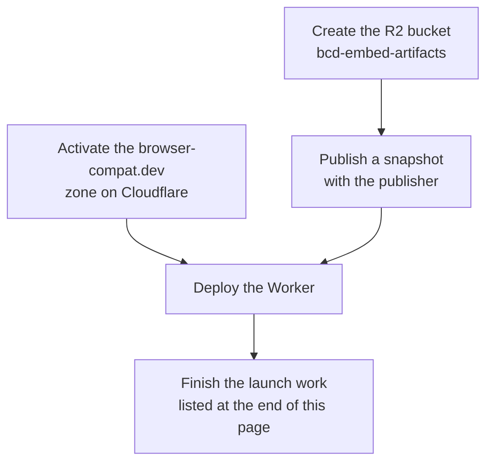
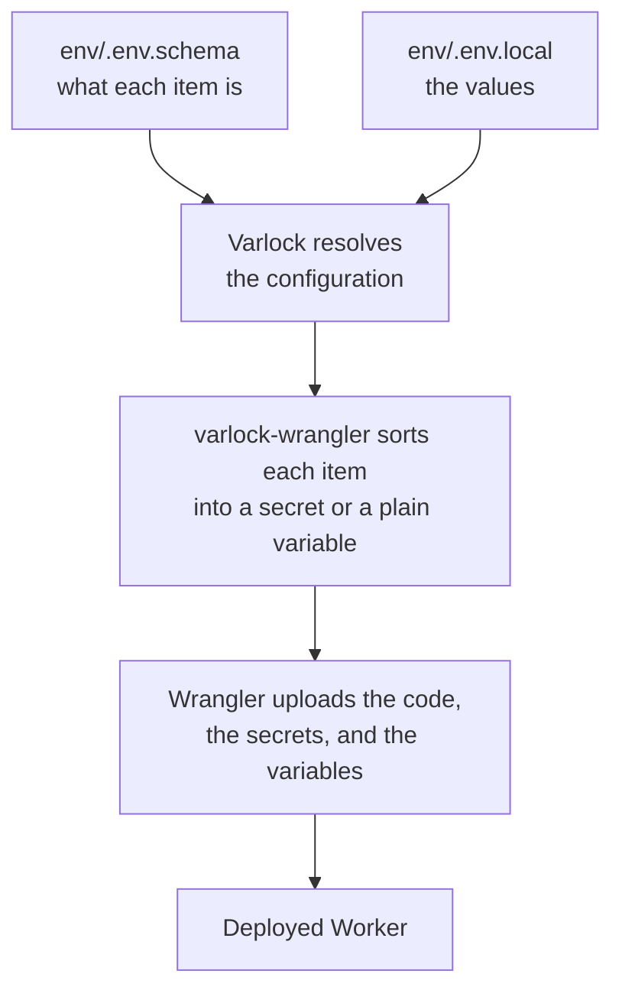

The Worker is the program on Cloudflare's network that answers API requests by
reading files from an R2 bucket. This page explains what has to be in place
before you deploy it, how its configuration reaches Cloudflare, and what one
deploy changes. For where the Worker sits in the whole pipeline, see
[How bcd-embed works](/).

The Worker's code is in
[`apps/worker`](https://github.com/schalkneethling/bcd-embed/tree/main/apps/worker).
Its [README](https://github.com/schalkneethling/bcd-embed/blob/main/apps/worker/README.md)
describes how it caches, negotiates compression, and reports errors.

## What must exist before a deploy

A deployed Worker with nothing to read can only return errors, so the order
matters.



The bucket name `bcd-embed-artifacts` is set in `apps/worker/wrangler.jsonc`.
The bucket is a deployment prerequisite, not something this repository
creates: no command here provisions a bucket or uploads objects as part of a
deploy.

An operator creates the bucket and then publishes a snapshot with
`@bcd-embed/publisher`, which uploads the immutable objects a snapshot needs
and writes `v1/meta.json` last. [How publication works](/publication/) describes
that process. Do not deploy against an empty bucket, and do not assume the
metadata the generator writes to disk is already a safe remote publication.

## Where the Worker answers

The Worker answers only on `https://api.browser-compat.dev`, a Workers Custom
Domain. Three fields in `apps/worker/wrangler.jsonc` set this up:

| Field                 | What it does                                                                                                                                        |
| --------------------- | --------------------------------------------------------------------------------------------------------------------------------------------------- |
| `routes`              | Attaches the Worker to `api.browser-compat.dev`. On deploy, Cloudflare creates the DNS record and a certificate for that hostname.                  |
| `workers_dev: false`  | Removes the `workers.dev` address. Turning it off only in the dashboard does not last, because the next Wrangler deploy turns it back on.           |
| `preview_urls: false` | Turns off preview and version addresses. Turning off `workers.dev` leaves these on, and they would let clients reach the Worker around rate limits. |

The `browser-compat.dev` zone must be active on Cloudflare before a deploy,
because a Custom Domain can only be created on an active zone. The zone must
have no DNS record of its own for `api.browser-compat.dev`, since Cloudflare
creates that record. Why the API moved off `workers.dev` is explained in
[Document 9](https://github.com/schalkneethling/bcd-embed/blob/main/docs/planning/09-custom-domain-and-rate-limits.md).

## Rate limiting

One Cloudflare rate limiting rule protects the API. It belongs to the
`browser-compat.dev` zone, not to this repository, so it is created in the
Cloudflare dashboard. A deploy does not change it. These are its settings:

| Setting    | Value                       |
| ---------- | --------------------------- |
| Match      | URI path starts with `/v1/` |
| Counted by | IP address                  |
| Requests   | 300                         |
| Period     | 10 seconds                  |
| Action     | Block                       |
| Duration   | 10 seconds                  |

A blocked request gets Cloudflare's own HTML `429` page, and the Worker never
runs, so it does not count as a Workers request. The page has no CORS header,
so a browser reports a blocked request to the component as a network error.
[Document 9](https://github.com/schalkneethling/bcd-embed/blob/main/docs/planning/09-custom-domain-and-rate-limits.md)
explains why the zone's plan fixes most of these settings, and records the
test that tripped the rule.

## How configuration reaches the Worker

The Worker has one configuration value today: `SENTRY_DSN`, the address that
runtime errors are reported to. It is optional. Without it the Worker runs with
Sentry, the error-reporting service, turned off.

[Varlock](https://varlock.dev) manages that value. Varlock is a tool that reads
a schema describing each configuration item, finds the value for it, and
checks the two against each other.

```
apps/worker/
├─ wrangler.jsonc        Wrangler's configuration: Worker name, bucket binding
├─ package.json          points Varlock at env/ with the varlock.loadPath setting
└─ env/
   ├─ .env.schema        the schema; the only Varlock file in git
   └─ .env.local         the values; git-ignored, encrypted for this machine
```

Varlock's files are in `env/`, not beside `wrangler.jsonc`, for a specific
reason. Wrangler reads a `.env.local` that sits next to its configuration and
adds the keys to the types it generates. `worker-configuration.d.ts` would then
differ between a machine that has the DSN and CI, which does not, and the
type check would fail on the first.

### Setting the Sentry DSN

1. Add this line to `apps/worker/env/.env.local`:

   ```
   SENTRY_DSN=varlock(prompt)
   ```

2. Load the configuration:

   ```sh
   pnpm --filter @bcd-embed/worker exec varlock load
   ```

Varlock asks for the value, encrypts it for this machine, and writes the
encrypted form back to the file. The same command prints the resolved
configuration with secrets masked, so you can run it again to check the result.

### Sentry alerting

Errors go to the `bcd-embed` project in the `schalkneethling` Sentry
organization, which stores its data in the EU region. The deployed Worker and
the freshness workflows' failure jobs both report to it with the same DSN. The
workflows read it from the repository secret `SENTRY_DSN`, because their
`notify-failure` jobs run without a GitHub environment.

Three settings in Sentry belong to this setup, not to this repository:

| Setting                                              | Why                                                                                                    |
| ---------------------------------------------------- | ------------------------------------------------------------------------------------------------------ |
| Scrub IP addresses: on                               | Sentry otherwise records the IP address each event was sent from, which the Worker never sends itself. |
| Alert "bcd-embed: email on every new issue"          | Emails the maintainer when Sentry creates a new issue, for both Worker errors and pipeline failures.   |
| Alert "Send a notification for high priority issues" | Sentry's default for a new project. It is left as created.                                             |

Worker events carry the tags `component: worker` and
`event: bcd_embed_worker_error`. Pipeline events have the title
`Pipeline <event> <status>`, the logger `bcd-embed.pipeline`, and the tags
`event` and `status`. To test the pipeline path without a workflow run:

```sh
SENTRY_DSN='<dsn>' node scripts/notify-sentry.mjs setup_check failure
```

Each new `<event>` and `<status>` pair creates a new issue, so the alert emails
once per pair.

## Running a deploy

```sh
pnpm --filter @bcd-embed/worker run deploy
```

That script runs `varlock-wrangler deploy`. `varlock-wrangler` comes from
`@varlock/cloudflare-integration` and wraps Wrangler, Cloudflare's
command-line tool.



`varlock-wrangler` decides how each item reaches Cloudflare from what the
schema says about it:

| Item                                | What it becomes         |
| ----------------------------------- | ----------------------- |
| Marked `@sensitive` in the schema   | A Worker secret         |
| Any other item in the schema        | A plain Worker variable |
| `__VARLOCK_ENV`, which Varlock adds | A Worker secret         |

`SENTRY_DSN` is marked `@sensitive`, so it is a secret.

`__VARLOCK_ENV` is one extra secret that `varlock-wrangler` always uploads. It
holds the resolved configuration for Varlock's optional runtime helper. The
Worker does not read it.

### A deploy replaces the Worker's variables

`varlock-wrangler` passes `--keep-vars=false` to Wrangler, which means each
deploy replaces the Worker's variables with the ones in the schema. A variable
added in the Cloudflare dashboard is removed by the next deploy. Add new
variables to `env/.env.schema` instead.

## Checking a deploy without deploying

Two commands exercise the Worker without touching a Cloudflare account:

| Command                                            | What it does                                                          |
| -------------------------------------------------- | --------------------------------------------------------------------- |
| `pnpm --filter @bcd-embed/worker wrangler:dry-run` | Builds the deployable bundle and validates it                         |
| `pnpm --filter @bcd-embed/worker test`             | Runs the integration tests against a local R2 bucket and local Worker |

## What is still open before a public launch

These items are separate work that a deploy does not cover:

- A test under sustained load. The endpoint verifier and the rate limiting
  test have run against the live edge, but neither measures sustained
  traffic.
