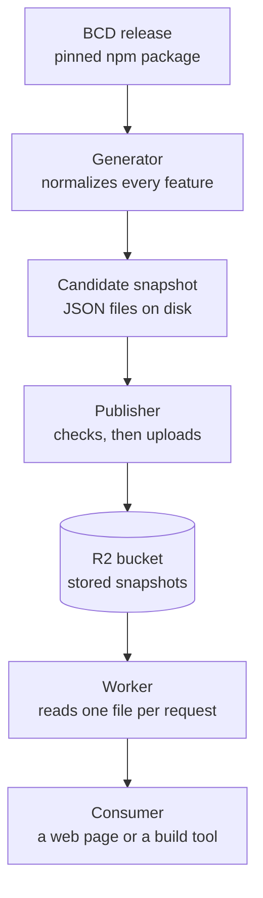
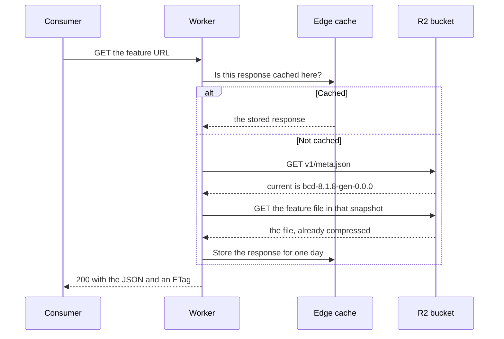

bcd-embed answers the question "which browsers support this web feature?" over
HTTP. The answers come from
[`@mdn/browser-compat-data`](https://github.com/mdn/browser-compat-data), the
dataset behind the compatibility tables on MDN, which this site calls BCD from
here on.

The API does no computation per request. Every answer is worked out ahead of
time, stored as a JSON file, and served as that file. This page shows the path
a BCD release takes to become those files, and what happens when a request
arrives.

## From a BCD release to an answer



Each box is one step, and each step has one job.

1. **A BCD release** arrives as a new version of the npm package. The
   repository pins one exact version, and Dependabot proposes each update as a
   pull request.
2. **The generator** reads the whole dataset once. For every feature it writes
   a normalized answer, a copy of the raw BCD entry, and compressed copies of
   both. The result is a **snapshot**: the complete set of files for one BCD
   release.
3. **The publisher** compares the new snapshot with the one that is live. A
   person reviews that difference and approves it. The publisher then uploads
   every file, and switches the live pointer only after the last one.
4. **R2** is Cloudflare's object storage. It holds the snapshots, and one small
   file, `v1/meta.json`, that names the current one.
5. **The Worker** is a small program on Cloudflare's network. It turns a
   request URL into a file name, reads that file from R2, and streams it back.
6. **The consumer** is whatever asked: today any HTTP client, and later the
   bcd-embed web component, which is designed but not built yet.

Steps 1 to 3 happen once per BCD release. Steps 5 and 6 happen on every
request. The split matters because BCD is large: BCD 8.1.8 has 20,933 features.
The expensive work runs once per release instead of once per visitor.

[How publication works](/publication/) covers steps 2 to 4 in detail.
[Deploying the Worker](/deployment/) covers step 5.

## How one request is answered

A consumer asks for the support data of one feature by its BCD key, for example
`css.properties.grid`:

```
GET /v1/current/features/css.properties.grid.json
```

`current` means "whichever snapshot is live". The Worker has to resolve that
word to a real snapshot name before it can find the file.



Three details in that diagram are easy to miss.

The **edge cache** is a store inside each Cloudflare data center. A cached
response skips both reads from R2. Only `current` routes and `meta.json` use
it. A request for a pinned snapshot, such as
`/v1/bcd-8.1.8-gen-0.0.0/features/…`, always reads R2, so that a snapshot
removed from `meta.json` stops being served straight away.

The file is **already compressed**. The generator stored a plain, a gzip, and a
Brotli copy of every file, and the Worker picks the one the client's
`Accept-Encoding` header allows. Nothing is compressed while the request waits.

The **ETag** is a fingerprint of the exact bytes sent. A client that already has
those bytes sends the fingerprint back in `If-None-Match` and receives a short
`304 Not Modified` response instead of the body.

## The endpoints

Every route is a `GET` that maps to one stored file. `{snapshot}` is either
`current` or a pinned snapshot name.

| Route                                   | What it returns                                           |
| --------------------------------------- | --------------------------------------------------------- |
| `/v1/meta.json`                         | The contract version, the snapshots, and the current one  |
| `/v1/{snapshot}/features/{key}.json`    | Normalized support data for a key and everything under it |
| `/v1/{snapshot}/raw/{key}.json`         | The untouched BCD entry for the same key                  |
| `/v1/{snapshot}/browsers.json`          | Browser names and release data                            |
| `/v1/{snapshot}/index.json`             | Every valid feature key                                   |
| `/v1/{snapshot}/index/{namespace}.json` | The keys of one BCD namespace, such as `css`              |

The full contract, including response shapes and errors, is in
[`01-api-contract.md`](https://github.com/schalkneethling/bcd-embed/blob/main/docs/planning/01-api-contract.md).

## Where each part lives in the repository

The repository is a monorepo: one repository that holds several packages, each
with its own README.

| Workspace            | Role in the diagram above                                            |
| -------------------- | -------------------------------------------------------------------- |
| `packages/schema`    | Defines the shape of every response, so all other parts agree on it  |
| `packages/core`      | Normalizes one BCD feature; the generator calls it for every feature |
| `packages/generator` | The generator: writes a snapshot to disk and compares two snapshots  |
| `packages/publisher` | The publisher: checks a snapshot and uploads it to R2                |
| `packages/server`    | Turns a request into a file read; has no Cloudflare-specific code    |
| `apps/worker`        | The Worker: connects the server to R2 and adds the edge cache        |
| `apps/docs`          | A playground that validates a response against the contract          |
| `apps/website`       | This documentation site                                              |

The design documents behind these parts are in
[`docs/planning`](https://github.com/schalkneethling/bcd-embed/tree/main/docs/planning).
