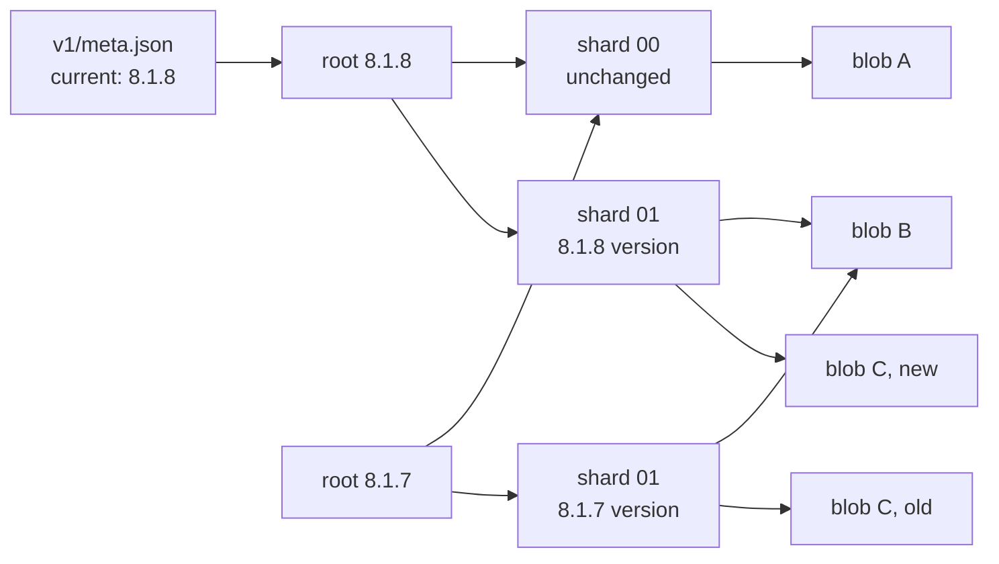
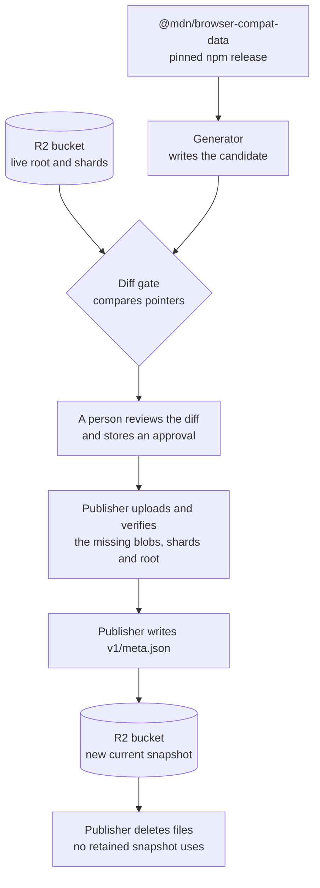
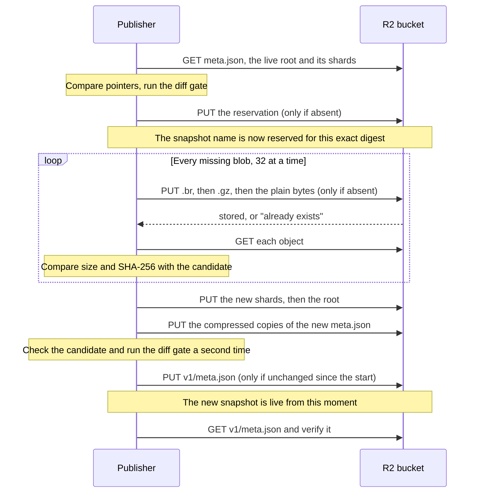

Publication copies one generated snapshot of browser-compat-data (BCD) into the
R2 bucket that the API reads from. The publisher uploads only the files the
live snapshot does not already have. This page explains what is in a snapshot,
how it reaches the bucket, why an interrupted upload is safe, and how to run a
publication.

:::caution[Status on 11 November 2026]
The generator and the publisher use the layout on this page, but no publication
has run against R2 with it yet. The Worker still reads the earlier layout, one
folder per snapshot, and cannot serve this one until it is updated. The timings
and operation counts below are therefore estimates unless a line says
"measured".
[Document 8](https://github.com/schalkneethling/bcd-embed/blob/main/docs/planning/08-incremental-publication.md)
tracks the remaining steps.
:::

The command-line tool that does the copying is the publisher, the
`@bcd-embed/publisher` package in
[`packages/publisher`](https://github.com/schalkneethling/bcd-embed/tree/main/packages/publisher). Its command
grammar and limits are in its [README](https://github.com/schalkneethling/bcd-embed/blob/main/packages/publisher/README.md). The
design reasoning is in
[Document 8](https://github.com/schalkneethling/bcd-embed/blob/main/docs/planning/08-incremental-publication.md). For where
publication sits in the whole pipeline, see [How bcd-embed works](/).

## What a snapshot holds

The Worker does no computation per request. It reads a ready-made JSON file
from R2, so every answer the API can give has to exist as a file before the
first request arrives. A snapshot is that complete set of files for one BCD
release.

The generator (`@bcd-embed/generator`) produces four kinds of file:

| Request path           | What one file holds                               | Files per snapshot              |
| ---------------------- | ------------------------------------------------- | ------------------------------- |
| `features/`            | The normalized support answer for one BCD feature | One per feature                 |
| `raw/`                 | The untouched BCD entry for the same feature      | One per feature                 |
| `index.json`, `index/` | Lists of feature keys                             | One, plus one per BCD namespace |
| `browsers.json`        | Browser names and release data                    | One                             |

BCD 8.1.8 has 20,933 features, which gives 41,880 files. Each file is stored
three times: plain, gzip-compressed (`.gz`) and Brotli-compressed (`.br`). The
Worker returns whichever one the browser accepts, which means nothing is
compressed while a request waits.

### Files are stored by their content, not by their name

Between two BCD releases, almost every file stays the same. From 8.1.7 to
8.1.8, 97.6% of the files were byte-identical (measured). Uploading all of them
again for each release is what the earlier design did, and it did not finish.

The layout therefore separates a file's bytes from the path that asks for it.
Four terms describe it.

A **blob** is one file's bytes, stored under the SHA-256 hash of those bytes.
Two files with the same bytes are the same blob, whichever release they belong
to. A **pointer** says which blob answers a request path in one snapshot. A
**shard** is one of 256 small files that together hold a snapshot's pointers;
a feature key's shard is chosen by the first byte of the SHA-256 hash of the
key. A **root** is one small file per snapshot that lists the hashes of its 256
shards, plus the pointers for `browsers.json` and the index files.

```
v1/
├─ meta.json               the only file that ever changes; names the current snapshot
├─ _meta/
│  └─ <sha256>.json.br     compressed copies of meta.json (.br and .gz)
├─ _publication/
│  └─ <snapshot>.json      the reservation: this snapshot's digest and timestamps
├─ snapshots/
│  └─ <snapshot>.json      the root, for example bcd-8.1.8-gen-0.0.0.json
├─ shards/
│  └─ <sha256>.json        about 82 pointers
└─ blobs/
   ├─ <sha256>.json        a file's plain bytes, stored once
   ├─ <sha256>.json.gz     the same file, gzip-compressed
   └─ <sha256>.json.br     the same file, Brotli-compressed
```

Everything except `v1/meta.json` is immutable: once an object is written, the
publisher never overwrites it. The `<sha256>` in a blob's name is the hash of
its plain bytes for all three encodings.

### How two snapshots share files



In this picture one feature changed between the two releases. The new snapshot
needed three new objects: the changed blob, the one shard that points to it,
and a root. Blob A, blob B and shard 00 are shared.

A root is built entirely from the hashes beneath it, so the hash of the root
file identifies the whole snapshot. That hash is the **digest** the rest of
this page refers to.

## From a BCD release to a live snapshot



Three terms in that diagram need a definition.

The **candidate** is the snapshot the generator just wrote to disk and that is
not live yet. The **baseline** is the snapshot that is live now. The publisher
does not download it. It reads `v1/meta.json`, the live root and the shards the
root names, which is at most 258 reads, and that gives it every pointer of the
live snapshot.

The **diff gate** compares the two sets of pointers. A feature counts as
changed when the hash of its normalized file or of its raw file differs. The
gate blocks the publication when the change is larger than the policy allows,
for example when too many features were removed. A first publication is always
blocked, because there is no baseline to compare with.

An **approval** releases one specific publication. It is a small JSON document
that names the digest of the baseline and of the candidate. The publisher
accepts it only when both digests match the snapshots in front of it, so an
approval cannot be reused for different data. It is stored in the
`BCD_EMBED_DIFF_APPROVAL` secret of the `bcd-embed-production` environment.

A root holds no timestamp. Generating the same BCD release again, with the same
generator version, therefore gives the same digest, and an approval stays valid
across reruns.

## What the upload does, object by object

The upload list is every blob and shard the candidate points to and the live
snapshot does not. The publisher treats each object on that list the same way:
write it, then read it back and compare the bytes.



"Only if absent" is a conditional write: R2 refuses the write when an object
with that name already exists. The publisher then reads the existing object,
and accepts it only when its bytes match what it was about to upload. That one
rule gives two guarantees. A published object can never be silently replaced,
and a second run over a half-finished upload continues instead of failing.

The order inside the loop matters. A blob's plain bytes are written last, so
the plain file's presence means that both compressed copies are stored too.
Shards are written after the blobs they point to, and the root after its
shards, so nothing in the bucket ever points to an object that is not there.

Every object is sent from memory. A request that fails in transit or passes
its 60-second deadline is sent again with the same bytes, up to three attempts.
An object that reads back with the wrong bytes is an integrity failure, and the
run stops without retrying it.

### Why an interrupted upload is safe

`v1/meta.json` is written last, and it is the only thing that tells the Worker
which snapshot is current. Until that write, the new blobs, shards and root are
in the bucket but nothing the Worker reads points at them.

```
before the upload      meta.json → root A        A is live
upload interrupted     meta.json → root A        A is live; some of B's blobs exist, unreferenced
upload finished        meta.json → root B        B is live; A stays listed until it expires
```

On a first publication there is no snapshot A and no `meta.json`, so an
interrupted upload leaves a bucket with nothing for the Worker to serve yet.

### What a second run does

A second run builds the same upload list, because the live snapshot has not
changed. For each object the first run already stored, the conditional write is
refused and the read-back verifies the stored copy. For the rest, the run
uploads them. Verifying the stored objects again is deliberate: it is how the
publisher knows that an interrupted run left them complete and uncorrupted.

The **reservation** is a small marker that binds a snapshot name to one digest
and one pair of timestamps, `generated` and `expires`. The workflow reads it
back before it generates the candidate and reuses those timestamps, because the
marker refuses different ones. A candidate whose content differs cannot reuse a
reserved name. In that case the approval no longer matches either, and the
publication needs a new review.

## Removing old data

An earlier snapshot stays listed in `v1/meta.json` until its expiry date, which
is at most 90 days after it was generated. The current snapshot is never
removed. Because snapshots share blobs, the publisher cannot delete an expired
snapshot's files directly. After every publication, and also when a run finds
nothing to publish, it does this:

1. It removes expired snapshots from `v1/meta.json`, before any bytes are
   deleted.
2. It reads the root and shards of every snapshot that `meta.json` still lists.
   Their pointers are the **live set**. If any of them cannot be read and
   verified, the run stops and deletes nothing.
3. It lists the blobs, shards and roots in the bucket, and deletes those that
   are not in the live set and are older than seven days.
4. It deletes compressed copies of earlier versions of `meta.json` that are
   older than seven days, once the current `meta.json` has been in place for a
   day.

The seven days protect a publication in progress, whose blobs are in the bucket
before anything points to them. The one-day wait in step 4 exists because the
Worker reads `meta.json` first and then asks for the compressed copy named by
its hash, so a request that read the previous `meta.json` just before a switch
still needs the previous copy.

`v1/meta.json` is read again before each batch of deletes. If it changed,
another publication ran at the same time, the live set is out of date, and the
run stops.

## What a publication costs

R2 bills writes and listings as Class A operations and reads as Class B. The
publisher counts both and prints them with its result, so a release that
changes far more than expected is visible in the job log.

| Publication                | Objects written | Storage added |
| -------------------------- | --------------- | ------------- |
| The first one, BCD 8.1.8   | about 122,100   | about 0.57 GB |
| 8.1.7 → 8.1.8, one release | 3,158           | 55.5 MB       |

The first row is every blob in three encodings, 256 shards and a root. The
second row is 972 new blobs in three encodings, 241 shards and a root. Both are
measured from generated snapshots on disk, not from a run against R2.

Each written object also costs one read to verify it. Cleanup adds about 257
reads for each snapshot `meta.json` lists, and one listing for every 1,000
stored objects.

No upload in this layout has been timed. The number of objects handled at the
same time is `UPLOAD_CONCURRENCY`, 32, in
[`packages/publisher/src/concurrency.ts`](https://github.com/schalkneethling/bcd-embed/blob/main/packages/publisher/src/concurrency.ts).
While it uploads, the publisher prints a line to the job log every 5,000
objects:

```
bcd-embed-publish: 35000 of 122093 objects verified in R2
```

## Running a publication

Publication is manual. It runs in the `publish` job of
[`freshness-backstop.yml`](https://github.com/schalkneethling/bcd-embed/blob/main/.github/workflows/freshness-backstop.yml), which
uses the `bcd-embed-production` environment and only runs from `main`.

Every publication through the workflow needs an approval, including one the
diff gate would let through. The publish step refuses to start without the
secret, and the publisher rejects an approval whose digests do not match the
snapshots it is about to compare. A publication therefore takes two runs: the
first produces the digests, and the second publishes them.

1. Start the workflow on `main` with `publish` set to true:

   ```sh
   gh workflow run freshness-backstop.yml --ref main -f publish=true
   ```

2. The run stops at the step named "Require reviewed exact-hash approval and
   publish", because no approval matches yet. Download the run's
   `bcd-embed-publication-…` artifact and read `publication-diff.json`. The
   step before it wrote that file by comparing the candidate with the live
   snapshot in R2, without writing anything. It lists the two digests, the
   feature counts, and any reasons the gate blocked the change.

3. If the diff is what you expect, store an approval in the environment secret.
   The four keys below are the only ones allowed, and the reason must be at
   least eight characters:

   ```json
   {
     "approved": true,
     "baselineDigest": "<64 hex characters from publication-diff.json>",
     "candidateDigest": "<64 hex characters from publication-diff.json>",
     "reason": "Why this change is expected"
   }
   ```

   ```sh
   gh secret set BCD_EMBED_DIFF_APPROVAL --env bcd-embed-production < approval.json
   ```

4. Start the workflow again with the same command as step 1.

5. When the run succeeds, the publish step's last line of output is a JSON
   result with `"type":"published"`, the name of the current snapshot, and
   three counts: what it uploaded, what cleanup deleted, and how many R2
   operations the run made.

### If a run fails or is cancelled

Start the workflow again. The reservation makes the rerun produce the same
candidate, the stored approval still matches, and the upload continues as
described in [What a second run does](#what-a-second-run-does).

Three failures need a person before a rerun:

| Message in the log                                                               | What it means                                                                                   |
| -------------------------------------------------------------------------------- | ----------------------------------------------------------------------------------------------- |
| `Approval digest does not match these exact baseline and candidate trees.`       | The candidate or the live snapshot changed after the approval was written. Review the new diff. |
| `Metadata committed but readback verification failed; investigate before retry.` | `v1/meta.json` was written but could not be read back and verified. Inspect the bucket first.   |
| `Metadata committed but retention cleanup failed; investigate before retry.`     | The new snapshot is live, but removing unused files failed. Inspect the bucket first.           |
