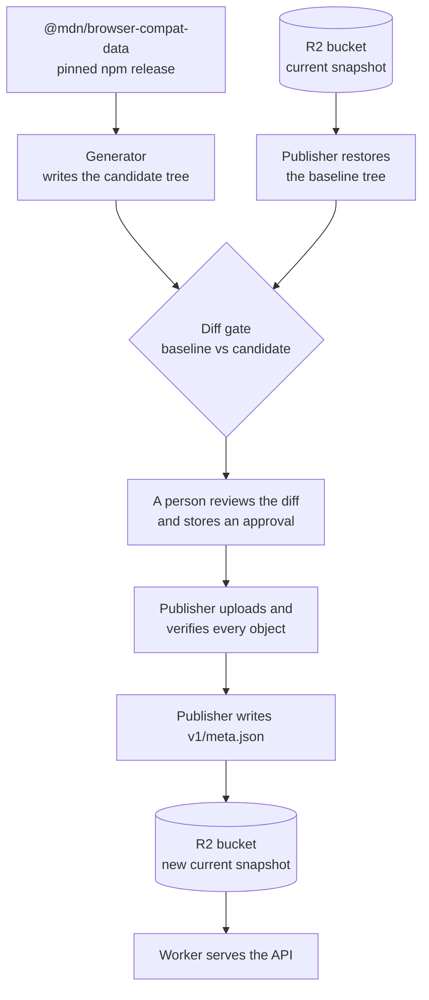
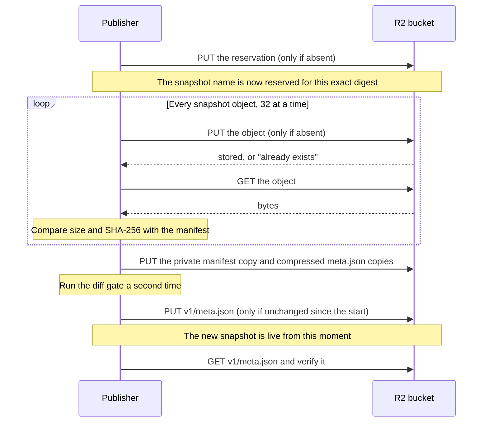

Publication copies one generated snapshot of browser-compat-data (BCD) into the
R2 bucket that the API reads from. This page explains what is in a snapshot,
how it reaches the bucket, why an interrupted upload is safe, and how to run a
publication.

The command-line tool that does the copying is the publisher, the
`@bcd-embed/publisher` package in
[`packages/publisher`](https://github.com/schalkneethling/bcd-embed/tree/main/packages/publisher). Its command
grammar and limits are in its [README](https://github.com/schalkneethling/bcd-embed/blob/main/packages/publisher/README.md). The
design reasoning is in
[`06-phase5-freshness.md`](https://github.com/schalkneethling/bcd-embed/blob/main/docs/planning/06-phase5-freshness.md). For where
publication sits in the whole pipeline, see [How bcd-embed works](/).

## What a snapshot holds

The Worker does no computation per request. It reads a ready-made JSON file
from R2, so every answer the API can give has to exist as a file before the
first request arrives. A snapshot is that complete set of files for one BCD
release.

The generator (`@bcd-embed/generator`) writes four kinds of file:

| Path                   | What one file holds                               | Files per snapshot              |
| ---------------------- | ------------------------------------------------- | ------------------------------- |
| `features/`            | The normalized support answer for one BCD feature | One per feature                 |
| `raw/`                 | The untouched BCD entry for the same feature      | One per feature                 |
| `index.json`, `index/` | Lists of feature keys                             | One, plus one per BCD namespace |
| `browsers.json`        | Browser names and release data                    | One                             |

Each file is stored three times: plain, gzip-compressed (`.gz`) and
Brotli-compressed (`.br`). The Worker returns whichever one the browser
accepts, which means nothing is compressed while a request waits.

That multiplication is why a snapshot is large. BCD 8.1.8 has 20,933 features:

```
20,933 features × 2 kinds (features, raw) × 3 encodings ≈ 125,600 objects
```

### Where the files live in the bucket

```
v1/
├─ meta.json               the only file that ever changes; names the current snapshot
├─ _meta/                  compressed copies of meta.json, named by content hash
├─ _publication/
│  └─ <snapshot>.json      the reservation: this snapshot's digest and timestamps
├─ _candidates/
│  └─ <snapshot>/          private copy of the manifest, used to restore a baseline
└─ <snapshot>/             for example bcd-8.1.8-gen-0.0.0
   ├─ browsers.json        browser names and release data
   ├─ index.json           every feature key
   ├─ index/
   │  └─ <namespace>.json  the feature keys of one BCD namespace, for example css
   ├─ features/
   │  └─ <key>.json        for example css.properties.grid.json
   └─ raw/
      └─ <key>.json        the untouched BCD entry for the same key
```

Everything except `v1/meta.json` is immutable: once an object is written, the
publisher never overwrites it. A snapshot name combines the BCD version and the
generator version, so the same inputs always produce the same name.

## From a BCD release to a live snapshot



Three terms in that diagram need a definition.

The **candidate** is the snapshot the generator just produced and that is not
live yet. The **baseline** is the snapshot that is live now, restored from the
bucket byte for byte. On the first publication the bucket is empty, so the
baseline is an empty directory.

The **diff gate** compares the two and blocks the publication when the change
is larger than the policy allows, for example when too many features were
removed. A first publication is always blocked, because adding every feature at
once exceeds every limit.

An **approval** releases one specific publication. It is a small JSON document
that names the SHA-256 digest of the baseline tree and of the candidate tree.
The publisher accepts it only when both digests match the trees in front of it,
so an approval cannot be reused for different data. It is stored in the
`BCD_EMBED_DIFF_APPROVAL` secret of the `bcd-embed-production` environment.

## What the upload does, object by object

The publisher treats every object the same way: write it, then read it back and
compare the bytes. It moves on only when the read matches.



"Only if absent" is a conditional write: R2 refuses the write when an object
with that name already exists. The publisher then reads the existing object,
and accepts it only when its bytes match what it was about to upload. That one
rule gives two guarantees. A published object can never be silently replaced,
and a second run over a half-uploaded snapshot continues instead of failing.

### Why an interrupted upload is safe

`v1/meta.json` is written last, and it is the only thing that tells the Worker
which snapshot is current. Until that write, the new snapshot's objects are in
the bucket but nothing points at them.

```
before the upload      meta.json → snapshot A        A is live
upload interrupted     meta.json → snapshot A        A is live; B is partly there, unreferenced
upload finished        meta.json → snapshot B        B is live; A stays until it expires
```

On a first publication there is no snapshot A and no `meta.json`, so an
interrupted upload leaves a bucket with nothing for the Worker to serve yet.

### What a second run does

A second run does not skip objects that are already in the bucket. For each
one it sends the conditional write, which R2 refuses, and then reads the object
back to verify it. That costs the same two requests as a fresh upload, so a
resumed run is about as slow as the first one for the part that was already
done. Verifying everything again is deliberate: it is how the publisher knows
that the objects from the interrupted run are complete and uncorrupted.

The **reservation** is what lets a later run rebuild the identical candidate.
The candidate's digest depends on its `generated` and `expires` timestamps. The
reservation stores those timestamps in the bucket, and the workflow reads them
back before it generates the candidate, so a rerun on a newer commit of `main`
produces the same bytes and the same digest. The digest changes only when the
BCD version, the generator version, or the generator's output changes. In that
case the approval no longer matches, and the publication needs a new review.

## How long it takes

Each object costs two requests in sequence, so the upload is limited by request
latency and not by processing power. The number of objects handled at the same
time is `UPLOAD_CONCURRENCY` in
[`packages/publisher/src/concurrency.ts`](https://github.com/schalkneethling/bcd-embed/blob/main/packages/publisher/src/concurrency.ts).

| Objects at a time | What the run did                      | Objects per minute | Time for 125,640 objects |
| ----------------- | ------------------------------------- | ------------------ | ------------------------ |
| 4                 | Uploaded new objects (measured)       | about 230          | about 9 hours            |
| 32                | Re-verified stored objects (measured) | about 3,850        | about 33 minutes         |
| 32                | Uploads new objects (estimated)       | about 1,840        | about 70 minutes         |

Both measurements are from 10 November 2026. The first live publication ran
with four at a time and was cancelled by the publish job's six-hour limit after
about 81,300 objects, the figure Cloudflare's write metrics recorded. The value
was raised to 32 for that reason. The estimate in the last row assumes that
uploading new objects scales with the number of parallel requests, and it has
not been measured.

The second run, with 32 at a time, re-verified about 60,000 stored objects in
19 minutes and then failed when a request passed the publisher's 60-second
deadline. No complete publication has finished with this flow.
[Document 8](https://github.com/schalkneethling/bcd-embed/blob/main/docs/planning/08-incremental-publication.md)
records the diagnosis and proposes a design that uploads only what changed.

While it uploads, the publisher prints a line to the job log every 5,000
objects:

```
bcd-embed-publish: 35000 of 125640 objects verified in R2
```

## Running a publication

Publication is manual. It runs in the `publish` job of
[`freshness-backstop.yml`](https://github.com/schalkneethling/bcd-embed/blob/main/.github/workflows/freshness-backstop.yml), which
uses the `bcd-embed-production` environment and only runs from `main`.

Every publication through the workflow needs an approval, including one the
diff gate would let through. The publish step refuses to start without the
secret, and the publisher rejects an approval whose digests do not match the
trees it is about to publish. A publication therefore takes two runs: the first
produces the digests, and the second publishes them.

1. Start the workflow on `main` with `publish` set to true:

   ```sh
   gh workflow run freshness-backstop.yml --ref main -f publish=true
   ```

2. The run stops at the step named "Require reviewed exact-hash approval and
   publish", because no approval matches yet. Download the run's
   `bcd-embed-publication-…` artifact and read `publication-diff.json`. It
   lists the two digests, the feature counts, and any reasons the gate blocked
   the change.

3. If the diff is what you expect, store an approval in the environment secret.
   The four keys below are the only ones allowed, and the reason must be at
   least eight characters:

   ```json
   {
     "approved": true,
     "baselineDigest": "<64 hex characters from publication-diff.json>",
     "candidateDigest": "<64 hex characters from publication-diff.json>",
     "reason": "Why this change is expected"
   }
   ```

   ```sh
   gh secret set BCD_EMBED_DIFF_APPROVAL --env bcd-embed-production < approval.json
   ```

4. Start the workflow again with the same command as step 1.

5. When the run succeeds, the publish step's last line of output is a JSON
   result with `"type":"published"` and the name of the current snapshot.

### If a run fails or is cancelled

Start the workflow again. The reservation makes the rerun produce the same
candidate, the stored approval still matches, and the upload continues as
described in [What a second run does](#what-a-second-run-does).

Two failures need a person before a rerun:

| Message in the log                                                               | What it means                                                                                 |
| -------------------------------------------------------------------------------- | --------------------------------------------------------------------------------------------- |
| `Approval digest does not match these exact baseline and candidate trees.`       | The candidate or the baseline changed after the approval was written. Review the new diff.    |
| `Metadata committed but readback verification failed; investigate before retry.` | `v1/meta.json` was written but could not be read back and verified. Inspect the bucket first. |
| `Metadata committed but retention cleanup failed; investigate before retry.`     | The new snapshot is live, but removing expired snapshots failed. Inspect the bucket first.    |
