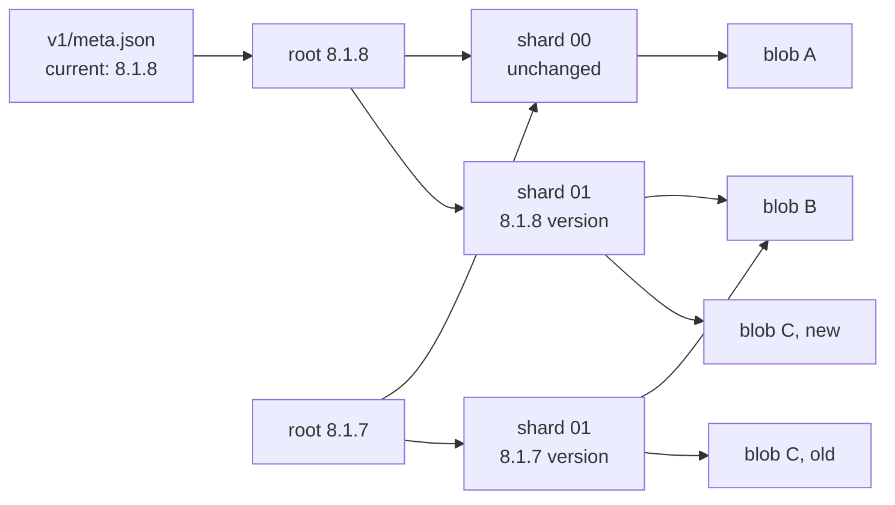
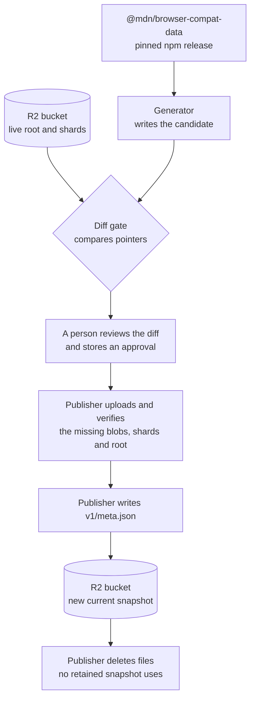
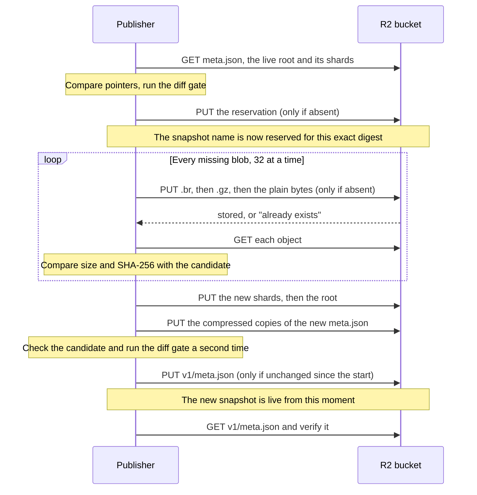

Publication copies one generated snapshot of browser-compat-data (BCD) into the
R2 bucket that the API reads from. The publisher uploads only the files the
live snapshot does not already have. This page explains what is in a snapshot,
how it reaches the bucket, why an interrupted upload is safe, and how to run a
publication.

:::note[Status on 17 November 2026]
The first publication in this layout ran on 14 November 2026 and made BCD 8.1.9
current. The deployed Worker has served this layout since 15 November, and since
17 November it answers only on `https://api.browser-compat.dev`. Numbers
on this page are measured unless a line says they are an estimate.
:::

The command-line tool that does the copying is the publisher, the
`@bcd-embed/publisher` package in
[`packages/publisher`](https://github.com/schalkneethling/bcd-embed/tree/main/packages/publisher). Its command
grammar and limits are in its [README](https://github.com/schalkneethling/bcd-embed/blob/main/packages/publisher/README.md). The
design reasoning is in
[Document 8](https://github.com/schalkneethling/bcd-embed/blob/main/docs/planning/08-incremental-publication.md). For where
publication sits in the whole pipeline, see [How bcd-embed works](/).

## What a snapshot holds

The Worker does no computation per request. It reads a ready-made JSON file
from R2, so every answer the API can give has to exist as a file before the
first request arrives. A snapshot is that complete set of files for one BCD
release.

The generator (`@bcd-embed/generator`) produces four kinds of file:

| Request path           | What one file holds                               | Files per snapshot              |
| ---------------------- | ------------------------------------------------- | ------------------------------- |
| `features/`            | The normalized support answer for one BCD feature | One per feature                 |
| `raw/`                 | The untouched BCD entry for the same feature      | One per feature                 |
| `index.json`, `index/` | Lists of feature keys                             | One, plus one per BCD namespace |
| `browsers.json`        | Browser names and release data                    | One                             |

BCD 8.1.8 has 20,933 features, which gives 41,880 files. Each file is stored
three times: plain, gzip-compressed (`.gz`) and Brotli-compressed (`.br`). The
Worker returns whichever one the browser accepts, which means nothing is
compressed while a request waits.

### Files are stored by their content, not by their name

Between two BCD releases, almost every file stays the same. From 8.1.7 to
8.1.8, 97.6% of the files were byte-identical (measured). Uploading all of them
again for each release is what the earlier design did, and it did not finish.

The layout therefore separates a file's bytes from the path that asks for it.
Four terms describe it.

A **blob** is one file's bytes, stored under the SHA-256 hash of those bytes.
Two files with the same bytes are the same blob, whichever release they belong
to. A **pointer** says which blob answers a request path in one snapshot. A
**shard** is one of 256 small files that together hold a snapshot's pointers;
a feature key's shard is chosen by the first byte of the SHA-256 hash of the
key. A **root** is one small file per snapshot that lists the hashes of its 256
shards, plus the pointers for `browsers.json` and the index files.

```
v1/
├─ meta.json               the only file that ever changes; names the current snapshot
├─ _meta/
│  └─ <sha256>.json.br     compressed copies of meta.json (.br and .gz)
├─ _publication/
│  └─ <snapshot>.json      the reservation: this snapshot's digest and timestamps
├─ snapshots/
│  └─ <snapshot>.json      the root, for example bcd-8.1.8-gen-0.0.0.json
├─ shards/
│  └─ <sha256>.json        about 82 pointers
└─ blobs/
   ├─ <sha256>.json        a file's plain bytes, stored once
   ├─ <sha256>.json.gz     the same file, gzip-compressed
   └─ <sha256>.json.br     the same file, Brotli-compressed
```

Everything except `v1/meta.json` is immutable: once an object is written, the
publisher never overwrites it. The `<sha256>` in a blob's name is the hash of
its plain bytes for all three encodings.

### How two snapshots share files



In this picture one feature changed between the two releases. The new snapshot
needed three new objects: the changed blob, the one shard that points to it,
and a root. Blob A, blob B and shard 00 are shared.

A root is built entirely from the hashes beneath it, so the hash of the root
file identifies the whole snapshot. That hash is the **digest** the rest of
this page refers to.

## From a BCD release to a live snapshot



Three terms in that diagram need a definition.

The **candidate** is the snapshot the generator just wrote to disk and that is
not live yet. The **baseline** is the snapshot that is live now. The publisher
does not download it. It reads `v1/meta.json`, the live root and the shards the
root names, which is at most 258 reads, and that gives it every pointer of the
live snapshot.

The **diff gate** compares the two sets of pointers. A feature counts as
changed when the hash of its normalized file or of its raw file differs. The
gate blocks the publication when the change is larger than the policy allows,
for example when too many features were removed. A first publication is always
blocked, because there is no baseline to compare with.

An **approval** releases one specific publication. It is a small JSON document
that names the digest of the baseline and of the candidate. The publisher
accepts it only when both digests match the snapshots in front of it, so an
approval cannot be reused for different data. It is stored in the
`BCD_EMBED_DIFF_APPROVAL` secret of the `bcd-embed-production` environment.

A root holds no timestamp. Generating the same BCD release again, with the same
generator version, therefore gives the same digest, and an approval stays valid
across reruns.

## What the upload does, object by object

The upload list is every blob and shard the candidate points to and the live
snapshot does not. The publisher treats each object on that list the same way:
write it, then read it back and compare the bytes.



"Only if absent" is a conditional write: R2 refuses the write when an object
with that name already exists. The publisher then reads the existing object,
and accepts it only when its bytes match what it was about to upload. That one
rule gives two guarantees. A published object can never be silently replaced,
and a second run over a half-finished upload continues instead of failing.

The order inside the loop matters. A blob's plain bytes are written last, so
the plain file's presence means that both compressed copies are stored too.
Shards are written after the blobs they point to, and the root after its
shards, so nothing in the bucket ever points to an object that is not there.

Every object is sent from memory. A request that fails in transit or passes
its 60-second deadline is sent again with the same bytes, up to three attempts.
An object that reads back with the wrong bytes is an integrity failure, and the
run stops without retrying it.

### Why an interrupted upload is safe

`v1/meta.json` is written last, and it is the only thing that tells the Worker
which snapshot is current. Until that write, the new blobs, shards and root are
in the bucket but nothing the Worker reads points at them.

```
before the upload      meta.json → root A        A is live
upload interrupted     meta.json → root A        A is live; some of B's blobs exist, unreferenced
upload finished        meta.json → root B        B is live; A stays listed until it expires
```

On a first publication there is no snapshot A and no `meta.json`, so an
interrupted upload leaves a bucket with nothing for the Worker to serve yet.

### What a second run does

A second run builds the same upload list, because the live snapshot has not
changed. For each object the first run already stored, the conditional write is
refused and the read-back verifies the stored copy. For the rest, the run
uploads them. Verifying the stored objects again is deliberate: it is how the
publisher knows that an interrupted run left them complete and uncorrupted.

The **reservation** is a small marker that binds a snapshot name to one digest
and one pair of timestamps, `generated` and `expires`. The workflow reads it
back before it generates the candidate and reuses those timestamps, because the
marker refuses different ones. A candidate whose content differs cannot reuse a
reserved name. In that case the approval no longer matches either, and the
publication needs a new review.

## Removing old data

An earlier snapshot stays listed in `v1/meta.json` until its expiry date, which
is at most 90 days after it was generated. The current snapshot is never
removed. Because snapshots share blobs, the publisher cannot delete an expired
snapshot's files directly. After every publication, and also when a run finds
nothing to publish, it does this:

1. It removes expired snapshots from `v1/meta.json`, before any bytes are
   deleted.
2. It reads the root and shards of every snapshot that `meta.json` still lists.
   Their pointers are the **live set**. If any of them cannot be read and
   verified, the run stops and deletes nothing.
3. It lists the blobs, shards and roots in the bucket, and deletes those that
   are not in the live set and are older than seven days.
4. It deletes compressed copies of earlier versions of `meta.json` that are
   older than seven days, once the current `meta.json` has been in place for a
   day.

The seven days protect a publication in progress, whose blobs are in the bucket
before anything points to them. The one-day wait in step 4 exists because the
Worker reads `meta.json` first and then asks for the compressed copy named by
its hash, so a request that read the previous `meta.json` just before a switch
still needs the previous copy.

`v1/meta.json` is read again before each batch of deletes. If it changed,
another publication ran at the same time, the live set is out of date, and the
run stops.

### Folders left by the old layout

Before the content-addressed layout, each snapshot was uploaded into its own
folder, `v1/<snapshot>/`. The BCD 8.1.8 upload abandoned on 10 November 2026
left 81,468 objects in `v1/bcd-8.1.8-gen-0.0.0/`; the workflow below deleted
them on 15 November 2026. Cleanup lists only `v1/blobs/`, `v1/shards/`,
`v1/snapshots/` and `v1/_meta/`, so it never removes such a folder.

The `Legacy snapshot cleanup` workflow deletes one. Dispatch it from `main` with
the snapshot identifier, and leave **execute** unchecked the first time. That
run prints how many keys the bucket holds under each top-level group of `v1/`
and how many are in the folder, and deletes nothing. Run it again with
**execute** checked to delete the folder. It deletes one page of up to 1,000
keys at a time, lists the folder again at the end, and fails if anything is
left. It refuses a snapshot that `meta.json` lists, and a snapshot identifier
always starts with `bcd-` and contains no slash, so the folder cannot overlap
the content-addressed prefixes. It runs in the `bcd-embed-production`
environment, which holds the R2 credentials.

## What a publication costs

R2 bills writes and listings as Class A operations and reads as Class B. The
publisher counts both and prints them with its result, so a release that
changes far more than expected is visible in the job log.

| Publication                | Objects written | Storage added | Measured from      |
| -------------------------- | --------------- | ------------- | ------------------ |
| The first one, BCD 8.1.9   | 122,312         | 586 MB        | the run against R2 |
| 8.1.7 → 8.1.8, one release | 3,158           | 55.5 MB       | snapshots on disk  |

The first row is every blob in three encodings, 256 shards and a root, written
on 14 November 2026. Its storage figure is the whole bucket afterwards, as
`wrangler r2 bucket info` reported it on 16 November. The second row is 972 new
blobs in three encodings, 241 shards and a root, measured by comparing two
generated snapshots; no release-to-release publication has run against R2 yet.

Each written object also costs one read to verify it. Cleanup adds about 257
reads for each snapshot `meta.json` lists, and one listing for every 1,000
stored objects.

The first publication uploaded and verified its 122,312 objects in about 40
minutes, roughly 50 objects a second. The number of objects handled at the same
time is `UPLOAD_CONCURRENCY`, 32, in
[`packages/publisher/src/concurrency.ts`](https://github.com/schalkneethling/bcd-embed/blob/main/packages/publisher/src/concurrency.ts).
While it uploads, the publisher prints a line to the job log every 5,000
objects:

```
bcd-embed-publish: 35000 of 122312 objects verified in R2
```

## Running a publication

Publication is manual. It runs in the `publish` job of
[`freshness-backstop.yml`](https://github.com/schalkneethling/bcd-embed/blob/main/.github/workflows/freshness-backstop.yml), which
uses the `bcd-embed-production` environment and only runs from `main`.

A publication needs an approval only when the diff gate blocks it, as it always
does for the first publication. The publish step reads the diff report and
passes the secret to the publisher only in that case. It does not pass it for
an unblocked diff, because the publisher rejects any approval whose digests do
not match the snapshots it is about to compare, so an approval left over from
an earlier publication would otherwise fail a routine one. The publisher
repeats the gate against the live snapshot itself, so an unblocked report never
lets a blocked diff through.

An unblocked publication finishes in one run. A blocked one takes two: the
first produces the digests, and the second publishes them.

1. Start the workflow on `main` with `publish` set to true:

   ```sh
   gh workflow run freshness-backstop.yml --ref main -f publish=true
   ```

   If the diff gate lets the change through, the run publishes and you can skip
   to step 5.

2. If the gate blocks the change, the run stops at the step named "Require
   reviewed exact-hash approval when the diff is blocked, and publish", because
   no approval matches yet. Download the run's
   `bcd-embed-publication-…` artifact and read `publication-diff.json`. The
   step before it wrote that file by comparing the candidate with the live
   snapshot in R2, without writing anything. It lists the two digests, the
   feature counts, and any reasons the gate blocked the change.

3. If the diff is what you expect, store an approval in the environment secret.
   The four keys below are the only ones allowed, and the reason must be at
   least eight characters:

   ```json
   {
     "approved": true,
     "baselineDigest": "<64 hex characters from publication-diff.json>",
     "candidateDigest": "<64 hex characters from publication-diff.json>",
     "reason": "Why this change is expected"
   }
   ```

   ```sh
   gh secret set BCD_EMBED_DIFF_APPROVAL --env bcd-embed-production < approval.json
   ```

4. Start the workflow again with the same command as step 1.

5. When the run succeeds, the publish step's last line of output is a JSON
   result with `"type":"published"`, the name of the current snapshot, and
   three counts: what it uploaded, what cleanup deleted, and how many R2
   operations the run made.

### If a run fails or is cancelled

Start the workflow again. The reservation makes the rerun produce the same
candidate, a stored approval for a blocked diff still matches, and the upload continues as
described in [What a second run does](#what-a-second-run-does).

Three failures need a person before a rerun:

| Message in the log                                                                             | What it means                                                                                   |
| ---------------------------------------------------------------------------------------------- | ----------------------------------------------------------------------------------------------- |
| `Approval digest does not match these exact baseline and candidate trees.`                     | The candidate or the live snapshot changed after the approval was written. Review the new diff. |
| `Metadata committed but readback verification failed; investigate before retry.`               | `v1/meta.json` was written but could not be read back and verified. Inspect the bucket first.   |
| `Metadata committed. Retention cleanup failed while <step>: <cause> Investigate before retry.` | The new snapshot is live, but removing unused files failed. Inspect the bucket first.           |

The cleanup message names the step that failed, such as `listing v1/blobs/ (page 3)` or
`deleting from v1/shards/`, and gives one of three causes: the publisher's own
explanation, `R2 responded with HTTP <status>.` for an R2 request that failed, or
`UnknownError`. It never prints an R2 error's name or message, because those can
contain request details. A rerun after a cleanup failure uploads nothing,
because the snapshot is already current, and it retries only the cleanup.

Cleanup pages through each prefix with the continuation token R2 returns, not
by asking for keys after the last one it saw. R2 does not list keys in byte
order: it returns `<hash>.json.br` and `<hash>.json.gz` before `<hash>.json`, so
a key-based position would skip or repeat objects. Before it deletes anything
from a page, cleanup checks that every key starts with the prefix and appears
once on the page, and that a page that continues has keys and a token it has
not seen before. If a check fails, cleanup stops and says which check failed
and at which position on the page, for example
`R2 returned key 2 of 1000 twice on the same page.` It never prints the key,
because R2 controls that text.

## Publishing a contract change

A change to the response contract, such as contract 1.1.0 adding
`versionAddedIsApproximate` to every summary, changes every feature file at
once. Three things make it different from a BCD update.

**The Worker goes first.** The Worker parses `v1/meta.json` before it reads any
snapshot file: for every feature, raw, `browsers.json` and index request, and
for a compressed request for `meta.json`. Some requests never reach that read:
an uncompressed request for `meta.json` itself, `OPTIONS`, an unknown route, an
invalid key, a method other than `GET` or `HEAD`, an unacceptable encoding, a
rate-limited request, and an edge cache hit for `meta.json` or a `current`
route. Before contract 1.1.0, the Worker accepted only the contract it was
built with, so a Worker built for 1.0.0 cannot read a 1.1.0 `meta.json`. Cache
hits can hide that failure for up to a day, which is why a rollback can look
fine at first and then fail as entries expire. Nothing in the publisher or the workflow checks which Worker is
live, so this order is the operator's responsibility. Every Worker from 1.1.0
on reads any contract listed in
`STORED_CONTRACT_VERSIONS` in `@bcd-embed/schema`, so it serves the 1.0.0
bucket before the publication and the 1.1.0 bucket after it. The publisher
reads the live `meta.json` the same way, which is how it can replace a 1.0.0
file.

**The snapshot needs a new name.** A snapshot's name is
`bcd-<BCD version>-gen-<generator version>`. The BCD version stays the same, so
the generator's version in `packages/generator/package.json` must go up, or the
publisher refuses the candidate because the live snapshot already has its name.
Contract 1.1.0 raised it from 0.0.0 to 0.1.0.

**The diff gate always blocks.** Every feature changes, so the changed-feature
count exceeds the policy and the publication needs an exact-digest approval.
The Freshness approvals file, `.github/freshness-approvals.json`, has no part in
this. Only Dependabot pull requests run that gate, and it generates both of its
trees with the same code, so it never compares two contracts.

The local output-diff commands cannot load a tree from an earlier contract:
they reject it at its `meta.json`, before the magnitude gate, and that check
stays strict. To preview the publication's diff on your own machine, compare
the earlier tree by its pointers alone, the way the publisher reads the live
snapshot. The script imports the built generator and schema packages, so build
them first:

```sh
pnpm --recursive --filter @bcd-embed/generator... run build
node scripts/compare-contract-change.mjs --baseline <tree from the earlier contract> --candidate <tree from this code>
```

It reads the baseline's `meta.json`, root and shards, checks the candidate in
full, and prints the same report the publisher writes to
`publication-diff.json`, plus the number of objects the upload will write. It
refuses a baseline that is already at the current contract.

### Contract 1.1.0, in order

These numbers come from comparing a BCD 8.1.9 tree generated by the code
before contract 1.1.0 with one generated by the code after it, on 19 November 2026. They assume BCD 8.1.9 is still the pinned release. If a BCD update
merges first, the snapshot names in steps 4 and 7 carry the new BCD version,
and the counts include that update's own changes:

| Measure                       | Value                                                                                              |
| ----------------------------- | -------------------------------------------------------------------------------------------------- |
| Changed features              | 20,968 of 20,968; none added or removed                                                            |
| Gate result                   | Blocked: changed feature magnitude only                                                            |
| New blobs                     | 20,982: every feature file, `browsers.json`, and the 13 indexes                                    |
| Objects to write              | 63,203: 20,982 blobs in three encodings, 256 shards, and a root                                    |
| Class A operations, estimated | about 63,400 with the marker, metadata and cleanup listings, 6.3% of the 1,000,000 free each month |
| Storage added                 | 533 MB; the 1.0.0 snapshot's own files go after it expires on 12 February 2027                     |

The raw files do not change, because they are BCD's own entries.

1. **Merge** the pull request. CI runs the full suite, the full-volume
   generation check and the core mutation gate.
2. **Record the Worker version that is live now**, so that you can return to
   it before step 4:

   ```sh
   pnpm --filter @bcd-embed/worker exec wrangler deployments list
   ```

3. **Deploy the Worker** from `main`, then check that it still serves the 1.0.0
   bucket:

   ```sh
   pnpm --filter @bcd-embed/worker run deploy
   node packages/server/scripts/verify-endpoint.mjs --base-url https://api.browser-compat.dev --allow-remote
   ```

4. **Generate and diff.** Start the publication:

   ```sh
   gh workflow run freshness-backstop.yml --ref main -f publish=true
   ```

   The run generates `bcd-8.1.9-gen-0.1.0`, compares it with the live
   `bcd-8.1.9-gen-0.0.0`, and stops at "Require reviewed exact-hash approval
   when the diff is blocked, and publish". That stop is expected. If the
   secret still holds the first publication's approval, the log says
   `Approval digest does not match these exact baseline and candidate trees.`
   instead; nothing has been written either way.

5. **Approve.** Download the run's artifact and read `publication-diff.json`:

   ```sh
   gh run download <run-id> -n bcd-embed-publication-<sha>-<run-id>-<attempt>
   ```

   Check that `blocked` lists only "Changed feature magnitude exceeds the
   reviewed policy.", and that the counts match the table above. Then store the
   approval as described in [Running a publication](#running-a-publication),
   step 3:

   ```sh
   gh secret set BCD_EMBED_DIFF_APPROVAL --env bcd-embed-production < approval.json
   ```

   This secret is the publication's approval. Nothing is merged for it, and
   no entry in `.github/freshness-approvals.json` is needed.

6. **Publish.** Run the same command as step 4. The candidate's digest is the
   hash of its root, which holds no timestamp, so the rerun produces the
   approved digest.
7. **Verify.** Check the bucket and the pinned routes, which the edge cache
   never holds, before anything that may be cached:

   ```sh
   pnpm --filter @bcd-embed/worker exec wrangler r2 object get bcd-embed-artifacts/v1/meta.json --remote --pipe
   curl -s https://api.browser-compat.dev/v1/bcd-8.1.9-gen-0.1.0/features/api.Attr.localName.json
   curl -s https://api.browser-compat.dev/v1/bcd-8.1.9-gen-0.0.0/features/api.Attr.localName.json
   node packages/server/scripts/verify-endpoint.mjs --base-url https://api.browser-compat.dev --allow-remote
   ```

   The bucket's `meta.json` should name contract `1.1.0` and current
   `bcd-8.1.9-gen-0.1.0`. That file is the publication's outcome. In the
   pinned 1.1.0 answer, Opera's summary should have `"versionAdded":"12.1"`
   and `"versionAddedIsApproximate":true`, because BCD records `≤12.1`. A
   pinned request reads `meta.json` from the bucket every time, so it answers
   `snapshot_not_found` if the switch did not happen. The pinned 1.0.0 answer
   should be unchanged and have no such field.

   The Worker keeps `/v1/meta.json` and every `/v1/current/…` answer in each
   data center's edge cache for up to a day
   (`max-age=86400, stale-while-revalidate=604800`). For that day a data center
   can still return the 1.0.0 `meta.json` or a 1.0.0 current answer, with a
   `bcd-embed-snapshot: bcd-8.1.9-gen-0.0.0` header. That is the cache, not a
   failed publication, and it is no reason to roll back. Judge the publication
   by the bucket's `meta.json` and the pinned routes above.

### Rolling back

Document 8 lists "`v1/meta.json` as the only mutable file, switched last by
compare-and-swap." Every other object is immutable, so the 1.0.0 snapshot stays
complete in the bucket, and its pinned URLs keep working, until it expires.

The boundary is the compare-and-swap of `v1/meta.json` near the end of step 6,
not the start of the step. Read the bucket's file to see which side you are on:

```sh
pnpm --filter @bcd-embed/worker exec wrangler r2 object get bcd-embed-artifacts/v1/meta.json --remote --pipe
```

While it still names contract `1.0.0`, the switch has not happened, and
returning to the version recorded in step 2 is safe:

```sh
pnpm --filter @bcd-embed/worker exec wrangler rollback <version-id>
```

Once it names `1.1.0`, or if the publisher reported that the switch's outcome
is unknown and you have not read the file, do not roll the Worker back to a
version from before contract 1.1.0. That version cannot read the 1.1.0
`meta.json`, so every request that reaches that read gets a 500 error, as the
edge cache entries expire over the following day. `wrangler rollback` without
a version ID returns to the previous deployment, which is a version from
before 1.1.0 until the Worker is deployed again. The publisher has no command that
makes an earlier snapshot current again, because it refuses to publish a
snapshot that is older than the live one. A problem in the 1.1.0 data is
therefore fixed forward: correct the generator, raise its version, and publish
through the same steps.
