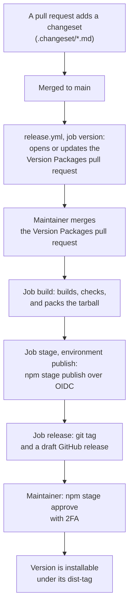

The web component is the one package this repository publishes to npm, as
`@schalkneethling/bcd-embed`. Every other workspace sets `private` to `true`.
A release never publishes straight from CI: the release workflow _stages_ the
version on npm, and it stays invisible to installs until a maintainer approves
it with two-factor authentication (2FA). This page covers the one-time setup,
each release, leaving the beta, and rolling back.

The package is in pre-release mode: versions look like `0.1.0-beta.0` and go
to the `beta` dist-tag, a name that points at one version, so
`npm install @schalkneethling/bcd-embed@beta` installs the newest beta.

## How a release moves



Each push to `main` runs
[`.github/workflows/release.yml`](https://github.com/schalkneethling/bcd-embed/blob/main/.github/workflows/release.yml).
Its first job, `plan`, decides what the push means:

| What `plan` finds                                                                   | What runs                                                     |
| ----------------------------------------------------------------------------------- | ------------------------------------------------------------- |
| A changeset file in `.changeset/`, other than its `README.md`                       | `version` opens or updates the Version Packages pull request. |
| No pending changeset, and no git tag for the package's version yet                  | `build`, then `stage`, then `release`.                        |
| No pending changeset, and the git tag `@schalkneethling/bcd-embed@<version>` exists | Nothing. That version is already staged or published.         |

The git tag is the workflow's record that a version is staged. npm does not
list a staged version until it is approved, so without the tag every push to
`main` would try to stage the same version again.

Only the `stage` job holds an OpenID Connect (OIDC) token, the short-lived
credential GitHub gives a job so that npm can check which repository,
workflow, and environment it runs in. That job checks out nothing and installs
nothing: it uses the npm that Node.js 26.13.0 bundles, 11.20.0, and fails
before staging if that npm is older than 11.15.0, the first version that can
stage. So no code from the repository or its dependencies runs while the token
exists. No npm token is stored anywhere.

Before packing, the `build` job removes `devDependencies` and `scripts` from
the package's `package.json`. Consumers never need them, and the development
dependencies name the private, unpublished `@bcd-embed/schema`.

### Why Changesets does not publish

[Changesets](https://changesets.dev) writes the versions and the changelog, and
`changesets/action` opens the Version Packages pull request. Changesets'
publish step is not used, because
[Changesets does not support staged publishing](https://changesets.dev/guide/automating#trusted-publishing).
The workflow does the part of `changeset publish` that still applies: it
creates the git tag in Changesets' monorepo form,
`@schalkneethling/bcd-embed@<version>`, and a GitHub release whose notes are
the version's section of `packages/element/CHANGELOG.md`. Two things differ.
The release starts as a draft, because the version is not on npm until you
approve it, and it is marked as a prerelease when the version has a `-`.

## One-time setup

Do these steps once, in this order. Steps 5 to 8 must happen within two days
of each other, because npm expires a new trusted publisher that has not
completed a publish within two days of being created
([npm: trusted publishers](https://docs.npmjs.com/trusted-publishers)). npm's
documentation does not say whether staging a version counts as that publish,
so approve the first staged version inside the same two days, and check the
trusted publisher afterwards (step 8).

### 1. Turn on two-factor authentication

Turn on 2FA for your npm account (Account, then Security) and your GitHub
account. A security key or passkey resists phishing better than an
authenticator app, but either works. npm needs 2FA for `npm trust`,
`npm stage approve`, `npm dist-tag`, and `npm deprecate`.

### 2. Create the `publish` environment on GitHub

In the repository's Settings, open Environments and create an environment
named exactly `publish`. npm matches the name, case included.

- Under **Deployment branches and tags**, choose **Selected branches and
  tags** and add the branch `main`. Do not use a wildcard.
- Leave **Allow administrators to bypass configured protection rules**
  unchecked.
- Optionally add yourself under **Required reviewers**. Each staging run then
  waits for you to approve the deployment in GitHub before the `stage` job
  starts, which adds a human step before anything reaches npm.

### 3. Let GitHub Actions open pull requests

In Settings, Actions, General, check **Allow GitHub Actions to create and
approve pull requests**. The `version` job needs it to open the Version
Packages pull request.

### 4. Merge the release setup

Merge the pull request that added `release.yml`. The push to `main` finds the
first changeset, `.changeset/first-beta.md`, so the `version` job opens the
Version Packages (beta) pull request, which bumps the package to
`0.1.0-beta.0`. Nothing reaches npm yet. Leave that pull request open until
step 8.

### 5. Sign in to npm

Run this from an up-to-date checkout of `main`:

```sh
npm login
```

### 6. Claim the name and create the trusted publisher

[Fledgling](https://github.com/dmno-dev/fledgling) reads the `fledgling` block
in the root `package.json`: GitHub as the provider, the workflow file
`release.yml`, the environment `publish`, and `"publish": false`, which allows
the workflow to stage but not to publish directly. It skips every package
whose `private` is `true`, so it finds only `@schalkneethling/bcd-embed`.

Before you run it, read the `fledgling` block in the root `package.json` and
check that it says `"provider": "github"`, `"workflow": "release.yml"`,
`"environment": "publish"`, and `"publish": false`. The dry run does not print
those settings, so this is where you confirm them. Fledgling takes the
repository from the checkout's `origin` remote, which must be
`schalkneethling/bcd-embed`.

Then print the plan, which changes nothing:

```sh
npx fledgling@1.3.1 --dry-run
```

The plan lists the files of the placeholder it would publish, says it would
claim `@schalkneethling/bcd-embed` at `0.0.0`, and says it would set up
trusted publishing. Check that it names no other package. Then apply it:

```sh
npx fledgling@1.3.1 --yes
```

Fledgling publishes the placeholder from a temporary folder with
`npm publish --access public`, and then runs `npm trust github` with
`--allow-stage-publish` and without `--allow-publish`. npm asks for 2FA in the
browser; tick the option that skips 2FA for the next five minutes so one
approval covers the whole run.

### 7. Confirm the trusted publisher and lock the package

```sh
npm trust list @schalkneethling/bcd-embed
```

This is the check of what Fledgling configured. The list should show one
GitHub configuration with the repository `schalkneethling/bcd-embed`, the
workflow `release.yml`, and the environment `publish`, and it should allow
staged publishing but not direct publishing. Then, on npmjs.com, open the
package's Settings and set publishing access to **Require two-factor
authentication and disallow tokens**.

An open npm issue reports a new trusted publisher being refused with "package
not found" for about three hours before it started to work
([npm/cli#10265](https://github.com/npm/cli/issues/10265)). If the first
staging run fails that way, wait and re-run the failed jobs.

### 8. Release the first beta

Follow [Each release](#each-release) from its step 2 with the Version
Packages pull request that step 4 opened. When you reach its last step, also
deal with the placeholder, below. After the first approval, check that the
trusted publisher is still there:

```sh
npm trust list @schalkneethling/bcd-embed
```

If the list is empty, or a later staging run is refused although the
workflow and environment match, the configuration has probably expired, and
npm does not let you use or edit an expired one. Remove it and create it
again from the `fledgling` block. `npm trust revoke` takes the configuration's
id from `npm trust list`
([npm: npm trust](https://docs.npmjs.com/cli/v12/commands/npm-trust)), and
`fledgling sync` sets up trust for any package that has none:

```sh
npm trust revoke --id <id> @schalkneethling/bcd-embed
npx fledgling@1.3.1 sync
```

The new configuration has its own two days to complete a publish.

### The placeholder and the `latest` dist-tag

Fledgling publishes the placeholder `0.0.0` with the dist-tag `latest`, and
`npm install @schalkneethling/bcd-embed`, with no version or tag, installs
whatever `latest` points at. A publish moves `latest` only when it uses that
tag ([npm: dist-tag](https://docs.npmjs.com/cli/v12/commands/npm-dist-tag)),
and betas use `beta`, so after the first approval `latest` still points at
the empty placeholder. Check it, then point `latest` at the beta and deprecate
the placeholder:

```sh
npm dist-tag ls @schalkneethling/bcd-embed
npm dist-tag add @schalkneethling/bcd-embed@0.1.0-beta.0 latest
npm deprecate @schalkneethling/bcd-embed@0.0.0 "A placeholder that reserved the name. Install @schalkneethling/bcd-embed@beta."
npm view @schalkneethling/bcd-embed version
```

The last command should print `0.1.0-beta.0`. Until version 1.0, move `latest`
to each new beta in the same way, so that an install without a tag never gets
an older beta than `@beta` does.

## Each release

1. In the pull request that changes the component, add a changeset and commit
   the file it writes to `.changeset/`:

   ```sh
   pnpm exec changeset
   ```

   It asks for the bump (patch, minor, or major) and a summary, which becomes
   the changelog entry. In pre-release mode every bump produces the next beta,
   such as `0.1.0-beta.1`. A pull request that changes nothing a consumer sees
   needs no changeset.

2. After the merge, the `version` job updates the Version Packages pull
   request. GitHub does not start other workflows for a pull request that a
   workflow's own token opened or updated, so its required checks never
   report. Close the pull request and reopen it; your reopening starts the
   checks. Review the version and the changelog, then merge it.

3. The merge starts `build`, `stage`, and `release`. If the `publish`
   environment has a required reviewer, approve the deployment in the
   workflow run first.

4. Find the staged version, inspect it, and approve it. Approval asks for 2FA:

   ```sh
   npm stage list @schalkneethling/bcd-embed
   npm stage view <stage-id>
   npm stage download <stage-id>
   npm stage approve <stage-id>
   ```

   `npm stage download` saves the tarball, so you can check its files before
   approving. Approval publishes the version with the dist-tag it was staged
   with, `beta` while in pre-release mode; the tag cannot change after
   staging ([npm: npm stage](https://docs.npmjs.com/cli/v12/commands/npm-stage)).
   You can also approve on npmjs.com, in the package's Staged Packages tab.

5. While in pre-release mode, move `latest` to the new beta:

   ```sh
   npm dist-tag add @schalkneethling/bcd-embed@<version> latest
   ```

6. Open the draft release that the `release` job created on the repository's
   Releases page, and publish it.

### When a release run fails part way

Re-run the failed jobs of the same workflow run, from its page in the Actions
tab. A re-run builds from the same commit as the first attempt, and the
`release` job checks for the tag and the draft release before it creates
either, so it finishes whatever the first attempt left undone.

Do not wait for the next push to `main` instead. If `stage` succeeded but
`release` failed, there is no tag, so the next push plans to stage again: it
builds from the newer commit at the tip of `main`, not the version commit, and
npm refuses it, because that version is already staged. If the re-run cannot
create the tag either, create it by hand on the commit that the staged run
built, which the run's page shows, then publish a release for it:

```sh
git tag @schalkneethling/bcd-embed@<version> <commit>
git push origin refs/tags/@schalkneethling/bcd-embed@<version>
```

If you later add a tag ruleset that protects release tags, which the npm
publishing checklist recommends, it must still let GitHub Actions create tags
named `@schalkneethling/bcd-embed@*`, or the `release` job fails every time.

### When a staged version is wrong

Reject it, which asks for 2FA and removes it from the registry:

```sh
npm stage reject <stage-id>
```

Then delete the draft release and its tag, so that the workflow stages the
version again once it is fixed:

```sh
git push origin :refs/tags/@schalkneethling/bcd-embed@<version>
```

Fix the problem in a pull request. The next push to `main` stages the version
again, or you can re-run the release workflow's last run on `main` once the
fix is merged.

## Leaving pre-release mode for 1.0

When the component is ready for 1.0, leave pre-release mode in a pull request
and add a changeset for the release:

```sh
pnpm exec changeset pre exit
pnpm exec changeset
```

Choose a major bump, so the version goes from `0.x` to `1.0.0`. `pre exit`
changes `.changeset/pre.json` to say pre-release mode is ending, and the next
`changeset version` removes it. Once the Version Packages pull request is
merged, `plan` finds no pre-release mode and stages `1.0.0` with the dist-tag
`latest`, so approval moves `latest` without a manual step. The `beta`
dist-tag keeps pointing at the last beta; remove it if you no longer want it
installable by name:

```sh
npm dist-tag rm @schalkneethling/bcd-embed beta
```

After 1.0, a prerelease such as `1.1.0-beta.0` needs pre-release mode again
(`pnpm exec changeset pre enter beta`). The `plan` job fails a prerelease
version outside pre-release mode, because it would otherwise go to `latest`.

## Rolling a release back

A version number, once published, can never be published again, even after
it is unpublished, so the usual fix is a new version. These are the options,
from least to most drastic:

| Option                                                                                    | What it does                                                                                                                       |
| ----------------------------------------------------------------------------------------- | ---------------------------------------------------------------------------------------------------------------------------------- |
| `npm dist-tag add @schalkneethling/bcd-embed@<good-version> beta` (or `latest`)           | Points the dist-tag back at a good version, so new installs by tag get it. The bad version stays installable by its exact number.  |
| `npm deprecate @schalkneethling/bcd-embed@<bad-version> "<why, and what to use instead>"` | Keeps the version installable but shows the message to everyone who installs it. Deprecating with an empty message `""` undoes it. |
| `npm unpublish @schalkneethling/bcd-embed@<bad-version>`                                  | Removes the version. Allowed only within npm's unpublish policy, below.                                                            |

All three ask for 2FA. Release a fixed version through [Each release](#each-release)
afterwards.

[npm's unpublish policy](https://docs.npmjs.com/policies/unpublish) allows an
unpublish within 72 hours of publishing when no other public package depends on
the package. After 72 hours, it allows one only when no package depends on it,
it had fewer than 300 downloads in the last week, and it has a single owner.
Unpublishing every version blocks any new publish of the package for 24 hours.
Prefer deprecating and moving the dist-tag.

## What is not verified yet

These points could not be checked before the first release and are worth
watching on it:

- npm's documentation does not say whether a staged version carries a
  provenance statement after approval. npm generates provenance by itself for
  a trusted publish from a public repository, and `npm stage publish` shares
  that code, so it probably does. The package page on npmjs.com shows it if
  it does.
- npm's documentation does not say how long a staged version waits for
  approval before it expires.
- npm's documentation does not say whether staging a version counts as the
  first publish that keeps a new trusted publisher from expiring after two
  days, or whether only an approved version does. Step 8 of the one-time
  setup checks the trusted publisher after the first approval for that
  reason.
- The `stage` job passes the packed tarball to `npm stage publish`. npm's
  synopsis accepts a package spec, which includes a tarball path, but the first
  run is the first real use of it with this package.
