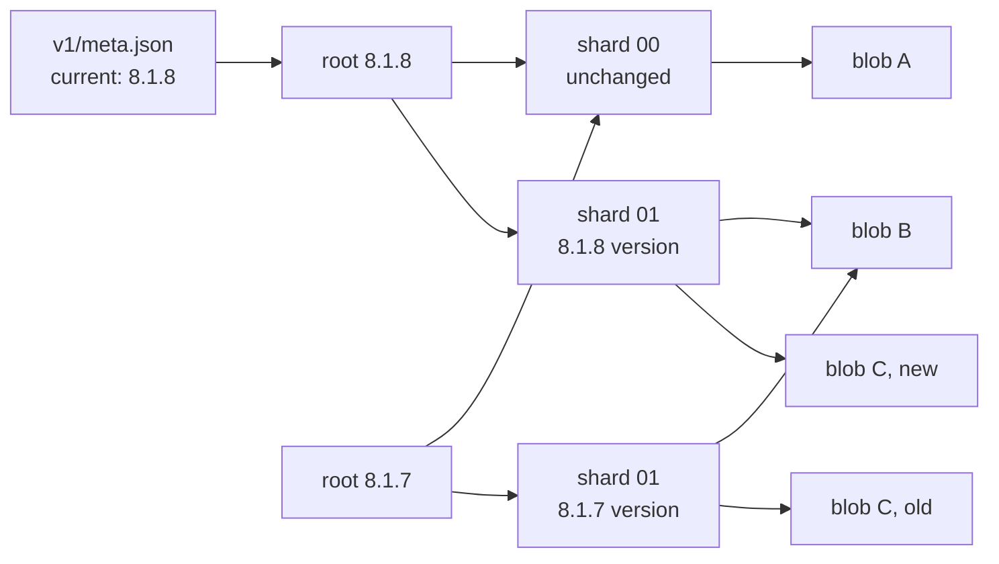
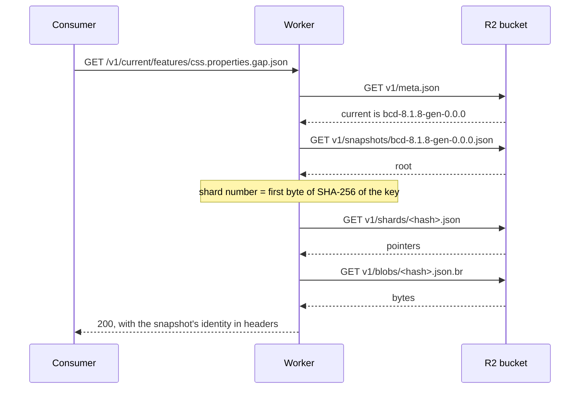

# Document 8 — Incremental publication

Status: proposal, awaiting review. Nothing in this document is implemented.

## Summary

Today every release of browser-compat-data (BCD) uploads a complete new copy of
the API's data: about 125,640 files. Between BCD 8.1.7 and 8.1.8, only 592 of
20,933 features changed. This document proposes storing each distinct file once,
named by the hash of its content, so that a release uploads only the files that
are new. Measured on that update, a release needs 3,158 writes where today's
design needs 125,640.

The change touches the API contract, the generator, the publisher and the
Worker. It is proposed now because nothing is live yet and nobody consumes the
API, which makes this the cheapest moment to change the contract.

## Why the current design is not sustainable

### What the first live publication showed

The first publication was attempted twice on 10 November 2026, and neither run
finished. The documentation site's page
[How publication works](../../apps/website/src/content/docs/publication.md) describes the flow
those runs followed.

| Run                                                                                | What happened                                                                                                 |
| ---------------------------------------------------------------------------------- | ------------------------------------------------------------------------------------------------------------- |
| [42777842228](https://github.com/schalkneethling/bcd-embed/actions/runs/42777842228) | Uploaded about 81,300 files in six hours at four files at a time, then hit the job's six-hour limit.          |
| [42831899716](https://github.com/schalkneethling/bcd-embed/actions/runs/42831899716) | Re-verified about 60,000 existing files in 19 minutes at 32 at a time, then stalled and failed on a deadline. |

Cloudflare's metrics for the bucket recorded no throttling and no server errors
in either run: 141,050 writes, 142,070 reads, 59,740 responses with status 412
(the refused writes of the second run), and zero responses with status 429 or
5xx.

The second run's stall has a likely cause that was reproduced locally but not
proven against R2. On a rerun the publisher streams every file again, and R2
refuses each one because it already exists. When the refusal arrives before a
large file's body has been sent, the Amazon S3 client never completes that
request and never returns its connection to the pool of 50. Once the pool is
empty, every request waits until the publisher's 60-second deadline fires. In a
local test against a fake server, files of 70 KB and more left connections
stuck when streamed, and none were left stuck when the same files were sent as
in-memory buffers.

### What a release costs today

R2 bills two classes of operation. Class A covers writes and listings. Class B
covers reads. A write that R2 refuses with status 412 is still billed as a
Class A operation.

| Resource          | Free each month | One publication today | Five publications a month |
| ----------------- | --------------- | --------------------- | ------------------------- |
| Class A (writes)  | 1,000,000       | 125,640               | 628,000                   |
| Class B (reads)   | 10,000,000      | about 377,000         | about 1,885,000           |
| Storage           | 10 GB           | 0.57 GB per snapshot  | 7.4 to 8.6 GB over 90 days |

The read figure includes downloading the live snapshot twice per publication to
rebuild the baseline, which was counted from the code and not measured.

Normal use fits the free allowance, but with room for only about three wasted
full uploads a month. R2 has no spending cap, so anything beyond the allowance
is billed automatically. BCD releases about weekly.

### How little actually changes

These figures come from the diff reports the Freshness workflow produced for
the last two BCD updates.

| Update                        | Added | Removed | Changed | Share of all features |
| ----------------------------- | ----- | ------- | ------- | --------------------- |
| 8.1.7 → 8.1.8 (one release)   | 35    | 0       | 557     | 2.8%                  |
| 8.1.3 → 8.1.7 (four releases) | 366   | 115     | 892     | 6.0%                  |

### The two things that force a full upload

**Every normalized file carries the release's timestamp and BCD version.** This
is the start of `features/css.properties.height.fit-content.json`:

```jsonc
{
  "contract": "1.0.0",
  "generated": "2026-11-09T22:19:15Z", // changes on every release
  "source": { "package": "@mdn/browser-compat-data", "version": "8.1.8" }, // changes on every release
  "query": "css.properties.height.fit-content",
  "browsers": {}, // changes rarely
  "features": [], // changes only when BCD's data for this feature changes
}
```

The two marked fields make all 20,933 normalized files differ byte for byte
between releases, even when the support data is identical. The `raw/` files
carry no such fields, so they are already identical when BCD's entry did not
change, and they are uploaded again anyway.

**Each snapshot is a folder with its own copy of every file.** The Worker reads
`v1/<snapshot>/features/<key>.json`, so a new snapshot needs every file under
its own name.

## Decisions already made

The project owner made these decisions on 10 November 2026.

1. Publication becomes incremental: a release uploads only what changed.
2. The `generated` and `source` fields leave the response body. They move to
   response headers and stay in `meta.json`.
3. The publisher reports its own count of R2 operations at the end of each run.
4. The interrupted first upload is abandoned. Finishing it would cost about
   44,000 more writes for a layout this proposal replaces.

Three usage alerts now exist on the Cloudflare account, each sent by email:
Class A operations above 700,000, Class B operations above 7,000,000, and
storage above 8 GB. They warn only; they do not stop usage.

## The proposed design

### Terms

A **blob** is one file's bytes, stored under a name derived from the SHA-256
hash of those bytes. Two files with identical bytes are the same blob, whichever
snapshot or feature they belong to. This approach is called content addressing.

A **pointer** says which blob answers a given request path in a given snapshot.

A **shard** is one of 256 small files that together hold all of a snapshot's
pointers. A feature key's shard is chosen by the first byte of the SHA-256 hash
of the key, which spreads keys evenly: about 82 keys and roughly 16 KB per
shard.

A **root** is one small file per snapshot that lists the hash of each of its
256 shards, plus the pointers for the few files that are not per-feature
(`browsers.json` and the index files).

### Bucket layout

```
v1/
├─ meta.json                        unchanged: the only mutable file, names the current snapshot
├─ blobs/
│  ├─ <sha256>.json                 a file's plain bytes, stored once
│  ├─ <sha256>.json.gz              the same file, gzip-compressed
│  └─ <sha256>.json.br              the same file, Brotli-compressed
├─ shards/
│  └─ <sha256>.json                 about 82 pointers; shared between snapshots when identical
└─ snapshots/
   └─ <snapshot>.json               the root: 256 shard hashes and the structural pointers
```

The `<sha256>` in a blob's name is the hash of the plain bytes for all three
variants, which is the rule the compressed copies of `meta.json` already
follow. Everything except `v1/meta.json` is immutable.

### How two snapshots share files



In this picture one feature changed between the two releases. The new snapshot
needed three new objects: the changed blob, the one shard that points to it,
and a root. Everything else is shared. Structures of this shape, where each
level names the level below by its hash, are called Merkle trees; Git stores
commits the same way.

Because a root is derived entirely from the hashes beneath it, the hash of the
root identifies the whole snapshot. That hash replaces today's tree digest in
the approval.

### How the Worker answers a request



The root and the shards never change once written, so the Worker can keep them
in memory and in Cloudflare's cache indefinitely. A request that finds both
cached costs the same two R2 reads as today: `meta.json` and the blob. A
request that finds neither costs four.

A key that has no pointer is answered the way a missing file is today, using
the index to tell `feature_not_found` from `namespace_not_queryable`.

### How a publication runs

1. Generate the candidate locally, as today, and hash every file.
2. Read the live snapshot's root and shards from R2: at most 257 reads. This
   replaces downloading all 125,640 files to rebuild the baseline.
3. Compare pointers. The set of hashes in the candidate that the live snapshot
   does not have is the upload list. The same comparison produces the diff
   report for the review gate.
4. Upload each missing blob from an in-memory buffer with a write that succeeds
   only if the name is unused, then read it back and verify it. A refused write
   means the blob already exists from an earlier snapshot or an interrupted
   run, and the read-back still verifies it.
5. Upload the new shards and the root.
6. Run the review gate a second time, then switch `v1/meta.json` with the same
   compare-and-swap as today.
7. Print the number of writes, reads and listings the run made.

An interrupted run leaves blobs that nothing points to yet. A rerun finds them
in step 4 and continues. Nothing is live until step 6.

### Removing old data

Today the publisher deletes an expired snapshot's folder. With shared blobs it
must first work out which blobs are still in use:

1. Read the root and shards of every snapshot that `meta.json` still lists.
   Their pointers form the set of live hashes.
2. List `v1/blobs/` and `v1/shards/`.
3. Delete what is not live and is older than a grace period of seven days.

The grace period protects blobs that a publication in progress has uploaded
but not yet pointed to. Listing costs about 130 Class A operations per pass,
and deletes are free.

## Changes to the API contract

Response bodies lose two fields, and responses gain three headers.

| Today, in every JSON body                  | Proposed                                                        |
| ------------------------------------------ | --------------------------------------------------------------- |
| `"generated": "2026-11-09T22:19:15Z"`      | Header `bcd-embed-generated: 2026-11-09T22:19:15Z`              |
| `"source": { "package": …, "version": … }` | Header `bcd-embed-source-version: 8.1.8`                        |
| The snapshot is known only from the URL    | Header `bcd-embed-snapshot: bcd-8.1.8-gen-0.0.0`                |

`meta.json` keeps all of these for every retained snapshot, so a consumer that
wants them as data reads them there. The three headers are added to
`access-control-expose-headers` so that browser scripts can read them.

This is a breaking change to contract 1.0.0, which states that every response
carries `source.version`. Because nothing has been published, the proposal is
to change 1.0.0 in place and not to introduce a second contract version.

One benefit follows from the change. A response's `ETag` is the hash of its
bytes. Today those bytes change on every release, so every consumer's cached
copy is invalidated weekly. With the release fields out of the body, a feature
that did not change keeps its `ETag` across releases, and a consumer's
revalidation gets a 304 with no body.

## Measurement: 8.1.7 against 8.1.8

Step 1 of the plan below is done. `scripts/measure-incremental-publication.mjs`
generates both snapshots in memory, removes `generated` and `source` from every
normalized body, and compares the SHA-256 hash of each file. The design passes
its gate: 97.6% of the files in 8.1.8 are byte-identical to 8.1.7, against a
threshold of 90%.

| Files in 8.1.8    | Identical | Changed | Added | Removed |
| ----------------- | --------- | ------- | ----- | ------- |
| Normalized        | 20,341    | 557     | 35    | 0       |
| Raw               | 20,521    | 377     | 35    | 0       |
| Index and browsers | 9        | 5       | 0     | 0       |
| **All 41,880**    | 40,871    | 939     | 70    | 0       |

The normalized row matches the Freshness diff report for the same update
exactly: 557 changed and 35 added. No repeated block changed in every file,
which was the main risk.

Three results differ from what this document assumed.

**Fewer writes than estimated.** The release needs 972 new blobs. Each has
three encodings, so that is 2,916 objects, plus 241 shards and one root: 3,158
writes, where the estimate was about 3,900.

**More storage than estimated.** The new blobs total 55.5 MB (52.2 MB plain,
1.9 MB gzip, 1.4 MB Brotli), where the estimate was about 20 MB. The changed
files are much larger than average because a parent feature's file contains its
whole subtree, so one changed method changes the file of its interface too.
Twenty files, led by `api.Element` at 3.4 MB, make up half the changed bytes.
At one release a week and 90 days of retention, about 13 releases add roughly
0.7 GB to a first snapshot of about 0.57 GB, which stays well inside the 10 GB
free allowance.

**Almost every shard changes.** 241 of the 256 shards differ, because 592
changed or added keys spread evenly over 256 shards touch nearly all of them.
Shards therefore save few writes between releases. They still cost only 8% of
the release's writes, and their main purpose is to keep each request's lookup
small: a shard holds between 60 and 106 keys.

Two smaller facts are worth recording. The 41,880 files reduce to 40,612
distinct blobs, because 1,268 files repeat bytes that another file in the same
snapshot already has. And the largest single body is 3.4 MB, which is small
enough to upload from memory as the design proposes.

The script hashes in memory instead of reading two generated folders because
the generator cannot write a snapshot to a case-insensitive filesystem, which
is the default on macOS: `api.Crypto.json` and `api.crypto.json` are the same
file there. Naming blobs by hash removes that collision for everything except
the staging folder, which step 3 should take into account.

## Cost after the change

The "proposed" column is the measurement above for the 8.1.7 to 8.1.8 update.
A release that changes more features costs proportionally more.

| Per publication  | Today                | Proposed                                    |
| ---------------- | -------------------- | ------------------------------------------- |
| Class A (writes) | 125,640              | 3,158: 2,916 blob objects, 241 shards, a root |
| Class B (reads)  | about 377,000        | about 3,400: 257 to read the live tree, one per write to verify it |
| Storage added    | 0.57 GB              | 55.5 MB                                     |
| Cost of a rerun  | up to 125,640 writes | only the writes not yet made                |

At five publications a month, writes come to about 16,000, which is 1.6% of the
free allowance where today's design uses 63%.

## What stays the same

- Request URLs, including pinned snapshot URLs.
- `v1/meta.json` as the only mutable file, switched last by compare-and-swap.
- Retention of 90 days for snapshots that are no longer current.
- The review gate, its policy limits, and approval bound to exact digests.
- Read-back verification of every object the publisher writes.
- The three encodings of every served file.

## Risks and open questions

**The share of unchanged files is measured for one release only.** It was
97.6% for 8.1.7 to 8.1.8. A blob changes whenever any byte changes, so if a
field that every feature file repeats, such as the `browsers` block, changes in
a later release, every normalized file changes with it. The publisher's
operation counts will show this if it happens. The remedy would be to move the
repeated block out of the per-feature file.

**Plain bytes dominate storage.** 94% of each release's new bytes are the
uncompressed encoding. Serving the plain encoding by decompressing a stored
copy would cut storage growth to about 3 MB per release, at the cost of work in
the Worker. Storage is not a constraint at the measured rate, so this document
does not propose it.

**The Worker's request path gains two lookups.** They are cacheable forever,
but a cold start pays for them. The Phase 4 latency checks need to be repeated.

**Cleanup is more complex and deletes shared data.** A bug could delete a blob
that a live snapshot needs. The mitigations are the grace period, deleting only
after a complete and verified read of every live root, and a dry-run mode that
prints what it would delete.

**Shard count.** 256 stays. The measurement shows that nearly every shard
changes in a release at any practical count, so fewer shards would save at most
a few hundred writes while making every request read a larger file.

**Header names.** `bcd-embed-generated`, `bcd-embed-source-version` and
`bcd-embed-snapshot` are now part of contract 1.0.0 (Document 1 §7) and are
exported from `@bcd-embed/schema` as `RELEASE_HEADERS`.

**The stuck-connection diagnosis is unproven against R2.** This design avoids
the pattern by sending buffers and by making refused writes rare, and the
publisher should log its connection pool's state so a recurrence is visible.

## Implementation sequence

1. **Measure.** Done: see [the measurement](#measurement-817-against-818).
   Generate two real snapshots, 8.1.7 and 8.1.8, with the release fields
   removed, and count identical files and changed shards. This is a script and
   a table; it changes no behavior. Stop and revisit the design if fewer than
   90% of files are identical.
2. **Contract.** Done. Remove `generated` and `source` from response bodies in
   `@bcd-embed/schema` and its fixtures, and add the three headers to Document
   1. The server already sends the headers, taken from the snapshot's entry in
   `meta.json`, so the contract and the implementation did not disagree in
   between. That part of step 5 is therefore complete.
3. **Generator.** Emit blobs, shards and a root. Document the Big O behavior of
   building the pointer tree, which is one pass over the artifacts.
4. **Publisher.** Compare pointers, upload missing blobs from buffers with
   retries, report operation counts, and replace folder deletion with the
   cleanup described above.
5. **Server and Worker.** Resolve requests through the root and shards, cache
   the immutable lookups, and repeat the latency checks. The headers were added
   in step 2.
6. **Clean the bucket.** Delete the roughly 81,000 objects the abandoned upload
   left. Deletes are free; listing them costs about 82 Class A operations.
7. **Publish and deploy.** Run the first publication, deploy the Worker, and
   run the live endpoint verifier.
8. **Documentation.** Rewrite the documentation site's page
   [How publication works](../../apps/website/src/content/docs/publication.md), which describes
   the flow this proposal replaces, and update the package READMEs.
