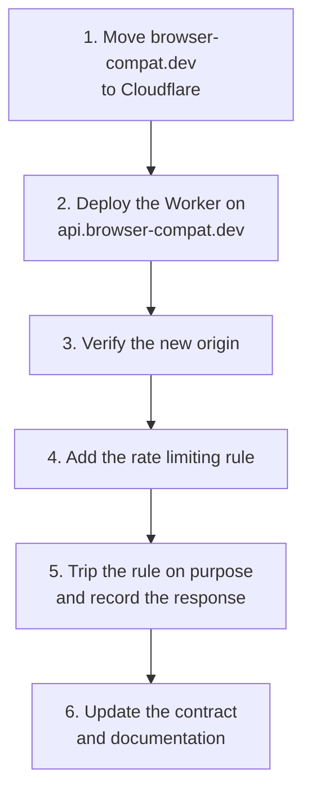

# Document 9 — Custom domain and rate limits

Status: proposal, awaiting review. Nothing in this document is implemented.

## Summary

The API Worker answers on its `workers.dev` address today, and nothing limits
how fast one client can call it. This document proposes moving the API to
`api.browser-compat.dev` and protecting it with one Cloudflare Web Application
Firewall (WAF) rate limiting rule. The rule belongs to the domain's Cloudflare
zone, and a zone requires a domain the project controls, which is why the
domain move comes first.

The work has six steps. Steps 1, 4 and 5 happen in the Cloudflare dashboard or
at the domain registrar. Steps 2, 3 and 6 change this repository.



Every Cloudflare statement below was checked against Cloudflare's developer
documentation on 17 November 2026, and every Wrangler setting against the
configuration schema of the pinned Wrangler 4.160.1. Where the documentation
does not answer a question, this document says so, and step 5 measures the
answer instead.

## Why a custom domain is needed

Rate limiting rules are created on a zone, which is a domain that Cloudflare
manages (Cloudflare,
[Rate limiting rules](https://developers.cloudflare.com/waf/rate-limiting-rules/)).
The `workers.dev` address belongs to Cloudflare's own zone, not to this
project. Cloudflare's `workers.dev` page names only one zone-level security
feature that runs there, Browser Integrity Check, and says nothing about WAF or
rate limiting rules. So a rule this project creates would have no zone to
attach to while the API lives on `workers.dev`.

The move has two further benefits. A public API needs a stable address that
does not change if the Worker or the Cloudflare account changes. And the
`workers.dev` address contains the account's subdomain, which should not
appear in the documentation that consumers read.

## Step 1: move browser-compat.dev to Cloudflare

The domain was registered at Hover and still uses Hover's name servers. A
Workers Custom Domain requires "an active Cloudflare zone" (Cloudflare,
[Custom Domains](https://developers.cloudflare.com/workers/configuration/routing/custom-domains/)),
so the owner must:

1. Add `browser-compat.dev` to the Cloudflare account as a zone on the Free
   plan.
2. Replace Hover's name servers with the two that Cloudflare assigns.
3. Wait until Cloudflare reports the zone as active.
4. Delete any DNS record for `api.browser-compat.dev` that Cloudflare copied
   from Hover. The documentation says a Custom Domain cannot be created on a
   hostname with an existing CNAME record. It does not say whether an existing
   A or AAAA record blocks it, so the safe choice is to start with no record
   for that hostname.

The apex `browser-compat.dev` stays free for the documentation site, which is
a separate decision.

## Step 2: deploy the Worker on api.browser-compat.dev

A Custom Domain, not a route, fits this Worker. Cloudflare recommends Custom
Domains "where your Worker is your application's origin server", and routes
where the origin is outside Cloudflare
([Routing](https://developers.cloudflare.com/workers/configuration/routing/)).
This Worker is the origin: it reads R2 directly.

The change to `apps/worker/wrangler.jsonc` is three fields. Each one matches
the pinned schema in `node_modules/wrangler/config-schema.json`:
`CustomDomainRoute` requires `pattern` and `custom_domain`, and `workers_dev`
and `preview_urls` are booleans.

```jsonc
{
  // ...existing fields
  "routes": [{ "pattern": "api.browser-compat.dev", "custom_domain": true }],
  "workers_dev": false, // removes the workers.dev address on the next deploy
  "preview_urls": false, // version and preview addresses are separate
}
```

Each field has a reason that comes from Cloudflare's documentation:

| Field                  | Why                                                                                                                                                                                                                                 |
| ---------------------- | ----------------------------------------------------------------------------------------------------------------------------------------------------------------------------------------------------------------------------------- |
| `routes`               | Cloudflare creates the DNS record and an Advanced Certificate for the hostname on deploy.                                                                                                                                           |
| `workers_dev: false`   | Wrangler infers `false` once `routes` exists, but the explicit value documents the intent. Turning `workers.dev` off only in the dashboard is undone by the next Wrangler deploy.                                                    |
| `preview_urls: false`  | Turning off `workers.dev` "does not disable Version URLs, Preview URLs, or Deployment URLs", and Wrangler leaves the existing setting unchanged when `preview_urls` is omitted. Without it, the API stays reachable around the rule. |

The deploy itself is unchanged: `pnpm --filter @bcd-embed/worker run deploy`.

## Step 3: verify the new origin

The endpoint verifier must pass against the new origin before the rule exists,
so that a later failure can be blamed on the rule and not on the move:

```bash
node packages/server/scripts/verify-endpoint.mjs --base-url https://api.browser-compat.dev --allow-remote
```

The verifier's two edge-specific checks were established on `workers.dev`, so
both need to hold again here:

- **The repeated compressed request.** The edge Cache API problem that forced
  the private-header storage format was observed on `workers.dev`. The Cache
  API page states that Workers on custom domains "have access to functional
  `cache` operations", without describing a difference from `workers.dev`. The
  verifier's repeated-request check settles it either way.
- **Cloudflare's own `400` for the `%ZZ` and `%00` probes.** The verifier
  accepts an HTML `400` with `server: cloudflare` for those two probes. The
  zone's settings could produce a different response, and the verifier will
  report it if they do.

The same step records latency from the same location as Document 8's
"Latency after deployment" section, and confirms that the old `workers.dev`
address no longer serves the API.

## Step 4: add the rate limiting rule

### What the Free plan allows

The zone is on the Free plan. Cloudflare's availability table for rate
limiting rules gives the Free plan these settings, with no room to choose:

| Setting                     | Free plan                                                                        |
| --------------------------- | -------------------------------------------------------------------------------- |
| Number of rules             | 1                                                                                |
| Counted by                  | IP address                                                                       |
| Counting period             | 10 seconds                                                                       |
| Mitigation timeout          | 10 seconds                                                                       |
| Fields in the rule's filter | Path, Verified Bot                                                               |
| Response                    | `429` by default. A custom response requires the Pro plan or above.              |
| Counting scope              | Each data center keeps its own counters. Updates can lag by a few seconds.       |

Two of these shape the design. The filter cannot name the hostname, so the
rule matches by path across the whole zone. And the response cannot be
changed, so a blocked client gets Cloudflare's response, not the contract's
`rate_limited` body.

### The proposed rule

| Setting       | Value                                                                    |
| ------------- | ------------------------------------------------------------------------ |
| Filter        | URI path starts with `/v1/`                                              |
| Counted by    | IP address (the only Free option)                                        |
| Threshold     | **Decision needed.** A starting proposal is 300 requests in 10 seconds.  |
| Period        | 10 seconds                                                               |
| Action        | Block                                                                    |
| Timeout       | 10 seconds                                                               |

The `/v1/` filter covers every API route, because the handler only answers
paths under `/v1/`, and it leaves the documentation site on the apex
uncounted.

The threshold must follow Document 2 §6: the limit "should not be tight enough
to break a documentation page with fifty tables". Document 3 §6 already
reduces what one page sends, because the component fetches lazily as tables
near the viewport and deduplicates requests for the same key, so fifty tables
send at most fifty feature requests. The proposal sets the threshold well
above that because one IP address can stand for many people: an office, a
school or a mobile carrier puts many readers behind one address. Three hundred
requests in ten seconds is still far below what a script mirroring the key
space would send. It is a starting value to revisit with traffic data, not a
measured one.

The rule is created in the Cloudflare dashboard. The repository does not use
Terraform or call the Cloudflare API, and one rule does not justify adding
either. The deployment page will record the rule's exact settings, so the
dashboard is not the only place they exist.

## Step 5: trip the rule on purpose and record the response

Cloudflare's documentation leaves three questions open, and each changes what
the component and the contract must say:

| Question                                                                     | Why it matters                                                                                                                  |
| ---------------------------------------------------------------------------- | ------------------------------------------------------------------------------------------------------------------------------- |
| Does the `429` carry `access-control-allow-origin`?                          | Without it, a browser hides the response from the component, which then sees a network error instead of a `429`.              |
| What content type and body does the `429` have, and does it send `Retry-After`? | The contract promises JSON errors, never HTML, and a `Retry-After` on `rate_limited`.                                        |
| Does a blocked request invoke the Worker or count toward Workers requests?   | The Workers pricing page defines billed requests as "inbound requests to your Worker" and does not say whether WAF blocks count. |

The test sends a bounded burst from one machine, above the threshold and
within one period, and stops at the first `429`. It records that response's
status, headers and body. The Worker's request count in the Cloudflare
dashboard, compared before and after, answers the third question. Document 2
§8 already asks for a `rate_limited` test "under actual rate-limit pressure in
a deployed environment", and this is that test.

## Step 6: update the contract and documentation

The edge `429` does not match the contract's `rate_limited` error, and on the
Free plan it cannot be made to. Document 1 §8 says errors are "JSON, never
HTML" and that `rate_limited` carries `Retry-After`. The contract needs to say
plainly that a rate limit applied at the edge may arrive in Cloudflare's own
format, and step 5's measurements decide the exact wording. The `%ZZ` and
`%00` probes already established the same kind of exception for Cloudflare's
own `400`.

The component needs a matching rule for Document 3 Phase 4: treat a `429`, or
a cross-origin failure, as "temporarily unavailable" and render the fallback
link to MDN rather than retrying in a loop.

These pages change with the work:

- Document 1 §8 and §10, for the edge `429`.
- `apps/website/src/content/docs/deployment.md`, for the custom domain, the
  rule's settings, and the launch list, which currently names "an
  account-level rate limit".
- `apps/worker/README.md`, for the verifier command with the new origin.
- `README.md` and the publisher README's launch status.

## What this design leaves out

A WAF rule counts requests, not bytes, and Cloudflare's documentation
describes no byte-based limit. So "bandwidth protection" in this project means
limiting requests and keeping responses cached, which the edge cache already
does. R2 charges nothing for egress.

The Workers Rate Limiting binding is the alternative that would return the
contract's own `429` with CORS headers, through the server's existing
`beforeRead` hook. It is not proposed now for three reasons. Cloudflare
advises against keying it on IP addresses. Its counts are also per data center
and eventually consistent. And the documentation does not state which Workers
plans include it. It remains an option if step 5 shows that the edge response
breaks the component badly.

## Decisions needed

| Decision                                  | Proposal                                                     |
| ----------------------------------------- | ------------------------------------------------------------ |
| API hostname                              | `api.browser-compat.dev`                                     |
| Rule threshold                            | 300 requests in 10 seconds per IP address, revisited later   |
| Workers plan for the account              | Unknown. On Free, Cloudflare stops the Worker for everyone after 100,000 requests a day (Error 1027), which is a cost ceiling but also an outage. |

## Sources

- Cloudflare, [Custom Domains](https://developers.cloudflare.com/workers/configuration/routing/custom-domains/): zone requirement, automatic DNS and certificate, CNAME conflict.
- Cloudflare, [Routing](https://developers.cloudflare.com/workers/configuration/routing/): when to use a Custom Domain or a route.
- Cloudflare, [workers.dev](https://developers.cloudflare.com/workers/configuration/routing/workers-dev/): disabling it, and what disabling leaves on.
- Cloudflare, [Version URLs](https://developers.cloudflare.com/workers/versions-and-deployments/version-urls/): `preview_urls` behavior.
- Cloudflare, [Rate limiting rules](https://developers.cloudflare.com/waf/rate-limiting-rules/): plan availability and counting delay.
- Cloudflare, [Rate limiting parameters](https://developers.cloudflare.com/waf/rate-limiting-rules/parameters/): actions and the default `429`.
- Cloudflare, [Request rate calculation](https://developers.cloudflare.com/waf/rate-limiting-rules/request-rate/): counters per data center.
- Cloudflare, [Create a rate limiting rule in the dashboard](https://developers.cloudflare.com/waf/rate-limiting-rules/create-zone-dashboard/): custom responses require Pro or above.
- Cloudflare, [Workers limits](https://developers.cloudflare.com/workers/platform/limits/) and [pricing](https://developers.cloudflare.com/workers/platform/pricing/): the Free daily limit and billed requests.
- Cloudflare, [Cache API](https://developers.cloudflare.com/workers/runtime-apis/cache/): cache operations on custom domains.
