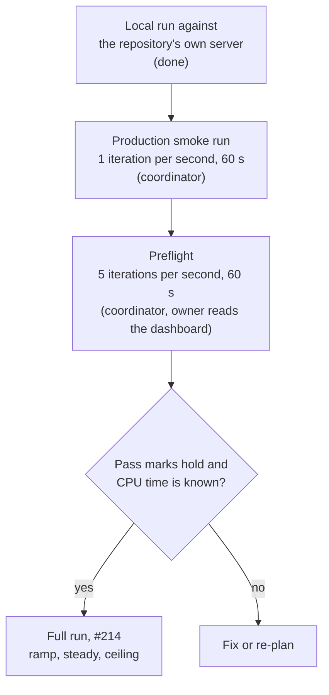

# Document 11 — Load test: plan, script and preflight

Status: the plan, the script and the local checks are done (22 November 2026). Nothing has run against
production. The preflight, the 60-second production run and the full run (#214) are the coordinator's steps,
and section 9 gives their exact commands.

## Summary

The test answers one question: does `api.browser-compat.dev` stay correct, fast and cheap while one client
sends 20 to 24 requests per second for minutes at a time? It runs from the owner's Mac, which is one IP
address, so it also keeps clear of the zone's rate limiting rule. It does not answer how the API behaves under
a traffic spike, many clients, many data centres or real popularity. Section 2 says why and what that leaves
untested.



## 1. Goal

| Question                                                       | How the test answers it                                                      |
| -------------------------------------------------------------- | ---------------------------------------------------------------------------- |
| Does every route answer as documented for minutes on end?      | Checks on every response (section 5).                                        |
| Do compressed bodies decode to the identity bytes?             | The `compare` class (section 5).                                             |
| Does revalidation work, and how often does it give a 304?      | The `conditional` class and the `conditional_304` counter.                   |
| Does the Worker stay error free?                               | The 5xx stop condition and pass mark (sections 6 and 7).                     |
| How fast are hits and misses from one location?                | Latency pass marks and `cf-cache-status` counts (section 7).                 |
| What does a sustained run cost?                                | The cost estimate (section 8), which the preflight's dashboard reading fixes. |

## 2. One generator, and what that cannot show

The owner decided on 22 November 2026 that every generator runs on the owner's Mac. That is one IP address.
The zone's rate limiting rule blocks one IP address above 300 requests per 10 seconds (30 per second) on any
`/v1/` path for 10 seconds (`apps/website/src/content/docs/deployment.md`, "Rate limiting"). So the one
generator stays between 20 and 24 requests per second, which is 67% to 80% of the limit. No skip rule is used.

The issue imagined several generators and a spike phase above the limit. With one generator and the rule on,
neither is possible. The test therefore cannot show:

| Not shown                                  | Why                                                                                                                                         |
| ------------------------------------------ | ------------------------------------------------------------------------------------------------------------------------------------------- |
| A traffic spike                            | The generator cannot exceed 24 requests per second without tripping the rule, and a tripped rule ends the run.                              |
| Many clients                               | Every request comes from one address, one TLS connection pool and one browser-like header set. The rule's per-IP counting is never stressed with many addresses. |
| Other data centres                         | Cloudflare keeps a cache and a rate counter per data centre. One IP address reaches one data centre (Johannesburg, in Document 8's measurements), so the other caches stay cold and untested. |
| Real popularity                            | The mix is a judgement (section 4). Real embeds may concentrate on a few keys far more than this mix does, or spread wider.               |
| Behaviour above the rule                   | This test never provokes the rule. The `429` was probed on 20 November 2026 (`10-component-spikes.md`, #189): status `429`, `content-type: text/plain; charset=UTF-8`, a 17-byte body, `retry-after: 10`, `cache-control` of `no-store` and friends, and no `access-control-allow-origin`. Document 9 recorded an HTML page on 17 November, so the shape has changed once. |
| The rule's own accuracy                    | The rule's counters are per data centre and lag by seconds (Document 9). The test shows that 22.4 requests per second does not trip it, not where it trips exactly. |

The issue's criterion "a skip rule for one IP address on the Free plan" is **not tested, because the owner
chose one generator and no skip rule**. Nothing here records whether a skip rule runs before the rate limiting
rule, and nothing in the plan relies on one.

## 3. Phases and rates

Rates are iterations per second. An iteration sends one request, except a `compare` iteration, which sends
two. The mix has 2% `compare` iterations, so the average is 1.02 requests per iteration (section 4).

| Phase       | Executor                 | Iterations per second | Requests per second | Length (default)  | Why                                                                                      |
| ----------- | ------------------------ | --------------------- | ------------------- | ----------------- | ---------------------------------------------------------------------------------------- |
| `ramp`      | `ramping-arrival-rate`   | 1 rising to 20        | 1 to 20.4           | 60 s              | Warms the edge cache gradually, so a cold start cannot look like a rate problem.        |
| `steady`    | `constant-arrival-rate`  | 20                    | 20.4                | 600 s             | The lower bound of the issue's 20 to 24 range, held long enough to see sustained behaviour. |
| `ceiling`   | `constant-arrival-rate`  | 22                    | 22.4                | 300 s             | The top of what the plan allows. 24 per second is the issue's limit, and 22.4 leaves 2 for jitter. |

```
requests per second
 30 ┤ - - - - - - - - - - - - - - - - - - - - - -  rule: 300 per 10 s
 24 ┤ - - - - - - - - - - - - - - - - - - - - - -  plan's ceiling
 22 ┤                                   ┌─────────  ceiling phase
 20 ┤                       ┌───────────┘           steady phase
    ┤                  ╱────┘
  1 ┤ ramp ╱
    └────────────────────────────────────────────▶ time
      60 s          steady 600 s              300 s
```

The numbers come from three sources. The 300 per 10 seconds is the zone's rule (Document 9, "The proposed
rule"). The 20 to 24 range is the issue's. The 0.8 safety factor is this plan's reason: the issue found 28 per
second leaves only 7% slack under 30, so the plan keeps the top phase at 22.4, which leaves 25% slack
(`tests/load-test.test.ts` asserts it).

How the script keeps to the rate:

- The arrival-rate executors start a set number of iterations in each time unit (`rate` and `timeUnit` on
  the executor pages), so the rate does not follow the response time. A closed loop of virtual users (VUs)
  would speed up when the server is fast. The executor pages say that too few pre-allocated VUs reduce how long
  k6 can sustain the rate, which lowers the rate and is safe for the rule.
- `maxRedirects: 0` and `redirects: 0` mean no request the plan did not count.
- The script sets no retries.
- **`rps` is load-bearing, not a backstop.** The script sets `rps: 24` in its `options`, and the commands
  repeat it as `--rps 24`. The k6 options reference (`using-k6/k6-options/reference/`) lists `rps` as a
  script option, environment variable `K6_RPS`, and flag `--rps`, with the description "The maximum number of
  requests to make per second, in total across all VUs", and marks it discouraged: it "has caveats and is
  difficult to use correctly", each instance of a cloud or distributed run applies the limit alone, and the
  page recommends the arrival-rate executors instead. Neither caveat applies to one local process. The
  executors do not cap a burst, though. After a stall they start the missed iterations at once. A review
  froze k6 with `kill -STOP` for 8 seconds during `PROFILE=ceiling` and measured it:

  | Setting                                  | Most requests in 1 second | Most requests in any 10 seconds |
  | ---------------------------------------- | ------------------------- | ------------------------------- |
  | No `rps` (reviewer's run)                | 66                        | 272                             |
  | No `rps` (my rerun, `--rps 0`)           | 53                        | 256                             |
  | `rps: 24` in `options`, no CLI flag      | 24                        | 240                             |
  | `rps: 24` in `options` and `--rps 24`    | 24                        | 240                             |
  | `rps: 24` in the review's run            | 25                        | 241                             |

  Without `rps`, only `maxVUs` kept the 10-second count under 300, by dropping iterations. A laptop sleep
  could plausibly pass 300. `maxVUs` is now three seconds of requests (66 at the ceiling, 60 in the ramp)
  so the executor cannot start a large backlog, which did not lower the steady rate in a local run
  (22.4 per second).
- **Run procedure.** Wrap the k6 command in `caffeinate -i` (`man caffeinate`: prevents idle sleep while the
  wrapped command runs), never suspend the run, and send no other traffic from the Mac's IP address to
  `/v1/` while it runs. The rule counts every request from that address, so a browser tab on the
  documentation site that calls the API would add to the count and `rps` cannot see it.
- On 22 November 2026, a 60-second `ceiling` run against the local server sent 1,340 requests (22.3 per
  second). The most in any one second was 24, and the most in any 10-second window was 227, which is 76% of
  the rule's 300.

## 4. Request mix and the key list

Each iteration picks one class by weight. The classes follow how the component and its readers use the API
(Document 3 §6: lazy, deduplicated feature requests; Document 1 §9: encodings, caching and conditional
requests).

| Class              | Share | Route                                          | Encoding    | What it represents                                                     |
| ------------------ | ----- | ---------------------------------------------- | ----------- | ---------------------------------------------------------------------- |
| `popular_br`       | 32%   | `/v1/current/features/<popular key>.json`      | Brotli      | The common browser case for the most embedded features.               |
| `popular_gzip`     | 8%    | the same                                       | gzip        | Clients that do not offer Brotli.                                      |
| `popular_identity` | 2%    | the same                                       | none        | Scripts and tools that send no `Accept-Encoding`.                      |
| `sampled_br`       | 15%   | `/v1/current/features/<sampled key>.json`      | Brotli      | The long tail: 999 keys spread evenly over all 20,968, so most are cold for the edge cache. |
| `deep_br`          | 5%    | `/v1/current/features/<deep key>.json`         | Brotli      | Keys with six or more segments, such as `api.Foo.bar.baz_parameter`.   |
| `pinned_br`        | 10%   | `/v1/bcd-8.1.9-gen-0.1.0/features/<key>.json`  | Brotli      | Pages that pin a snapshot. The Worker does not edge-cache these, so each reads R2. |
| `raw_br`           | 2%    | `/v1/current/raw/<popular key>.json`           | Brotli      | The raw representation route.                                          |
| `conditional`      | 10%   | `/v1/current/features/<hot key>.json`          | Brotli      | Returning readers. See below.                                          |
| `meta`             | 3%    | `/v1/meta.json`                                | 70/20/10    | Every client starts here. 70% Brotli, 20% gzip, 10% identity.          |
| `browsers`         | 3%    | `/v1/current/browsers.json`                    | Brotli      | The browser list, loaded once per page.                                |
| `index`            | 1%    | `/v1/current/index/<namespace>.json`, or `index.json` 1 time in 20 | Brotli | Discovery. `index.json` is 826,673 bytes plain, so it is rare. |
| `missing`          | 4%    | `/v1/current/features/<missing key>.json`      | Brotli      | A typo or a retired key. Expects a `404`.                              |
| `grouping`         | 1%    | `/v1/current/features/<namespace>.json`        | Brotli      | An organizational namespace such as `css.properties`. Expects a `404`. |
| `preflight`        | 2%    | `OPTIONS /v1/current/features/<popular key>.json` | none     | A browser's CORS preflight, which `If-None-Match` triggers cross-origin. Expects a `204`. |
| `compare`          | 2%    | the same popular key, compressed then identity | br or gzip  | The byte comparison (section 5). Sends two requests.                   |

The shares add up to 100 and the mean is 1.02 requests per iteration (`load-test/lib/mix.js`; the test file
checks both). The shares are this plan's judgement, not measured traffic, because no public traffic exists yet.
The reasoning behind the largest ones: most reads in the component are lazy feature fetches (the feature-route
classes add up to 91% of iterations: 86% that expect a 200 and 5% that expect a 404; 89% without `compare`), a smaller share are first-visit structural fetches (`meta`, `browsers`, `index`), and the error and
conditional classes are there to exercise their paths rather than to match a measured frequency.

**Where the keys come from.** `load-test/keys.json` holds public feature keys for the snapshot the Worker serves
today, `bcd-8.1.9-gen-0.1.0` (contract 1.1.0, source `@mdn/browser-compat-data` 8.1.9). `build-key-list.mjs` reads
the snapshot's `index.json` from a locally generated artifact folder. The generator is deterministic, so a local
run with generator 0.1.0 and BCD 8.1.9 reproduces the live snapshot's identifier. It sends no request.

| Group      | Count  | How it is chosen                                                                                       |
| ---------- | ------ | ------------------------------------------------------------------------------------------------------ |
| `popular`  | 49     | Hand-picked well known features (`css.properties.display`, `javascript.builtins.Array`, `api.fetch`, `html.elements.a` and so on). The builder fails if any one is missing from the index, so the list cannot drift silently. This is a judgement about popularity, not data. |
| `sampled`  | 999    | Every 21st key of the sorted index (stride `ceil(20,968 / 1,000)`), so it covers the whole alphabet and every namespace in proportion to its size. The first version used a stride of 20 capped at 1,000 keys, which never sampled the last 968 keys; the stride now rounds up. |
| `deep`     | 100    | Keys with six or more segments, spread evenly over the six namespaces that have them (20 each, and 1 from `css`, which has only 1), not in proportion to size. A proportional spread put 69 of the 100 in `webextensions.*`. |
| `grouping` | 40     | Prefixes up to two segments that are not themselves keys but are prefixes of keys.                      |
| `missing`  | 26     | `<namespace>.load_test_missing_01` and `_02` for each of the 12 namespaces, plus two keys under an unknown namespace. Few and repeated on purpose: the Worker caches a `404`, so unique missing keys would measure the miss path alone. |

The file holds no token or account detail. `tests/load-test.test.ts` checks that every popular, deep and
sampled key satisfies `featureKeySchema`, that each one is an addressable key in BCD 8.1.9, and that no missing
or grouping key is. The popular keys include some large payloads (`javascript.builtins.Array` is 641,987 bytes
plain), so the identity classes dominate bandwidth: a local 105-second `full` run received 36 MB, about
23 KB per request, which is 0.5 MB per second at the ceiling.

**Conditional requests.** A `conditional` iteration picks one of 9 hot keys, every sixth popular key (`api.AbortController`,
`api.Request`, `api.fetch`, `css.properties.color`, `css.properties.margin`, `css.selectors.is`,
`html.elements.input`, `javascript.builtins.Map`, `svg.elements.svg`). The popular list is sorted, so its first
eight keys would all have been `api.*`, which is why the first version's hot keys were all one namespace. If the virtual user already holds
that key's `ETag` (from an earlier Brotli response), it sends `If-None-Match` and expects a `304` with the same
`ETag` and no body. If not, it fetches the key normally (counted as `conditional_seed`) and remembers the tag.
Each virtual user keeps its own tags, so 304s grow over the run as users revisit the hot keys. An `ETag` is
strong and differs per encoding (Document 8), so conditional requests always use Brotli. The script counts 304s
in `conditional_304` apart from every 200 and 404, and it counts a `200` for a conditional request in
`conditional_not_304`, which fails the run.

## 5. What the script asserts

Every response goes through checks. A failed check does not stop the run (k6 documents `check` as returning a
boolean). The `checks` pass mark and the thresholds in section 7 decide the outcome.

| Response                     | Checks                                                                                                                                        |
| ---------------------------- | --------------------------------------------------------------------------------------------------------------------------------------------- |
| Feature, `current`           | `200`; JSON content type; strong `ETag` (64 hex digits); `bcd-embed-snapshot` equals the expected snapshot; `cache-control` is `max-age=86400, stale-while-revalidate=604800`; `access-control-allow-origin: *`; `content-encoding` is the requested one; body not empty. |
| Feature, pinned              | The same with `cache-control: max-age=31536000, immutable`.                                                                                   |
| `meta.json`                  | `200`; JSON; strong `ETag`; current cache policy; requested encoding; the body's `current` equals the expected snapshot and its `contract` equals `1.1.0`. |
| `browsers.json`, indexes     | `200`; JSON; current cache policy; snapshot header; Brotli.                                                                                   |
| `404` under `/v1/current/`   | `404`; JSON; error code `feature_not_found` or `namespace_not_queryable` as expected; `cache-control` is `max-age=3600` **or** `max-age=14400`. |
| Preflight                    | `204`; `allow: GET, HEAD, OPTIONS`; `access-control-allow-headers` includes `if-none-match`.                                                  |
| Conditional                  | `304`; same `ETag`; no body.                                                                                                                  |
| `compare`                    | Both `200`; compressed response really carries `content-encoding`; identity response carries none; **the compressed body decodes to the identity bytes**. |

**Cached 404s (#259).** A `404` under `/v1/current/` that the Worker serves from its edge cache reaches the
client with `max-age=14400`, where the Worker sets `max-age=3600`. Issue #259 suspects Cloudflare's Browser
Cache TTL and is not settled. The script therefore accepts both values for that one case, and counts how often
`14400` appears in `current_404_max_age_14400`. Accepting both is a decision to keep this test about load, not
about #259. If #259 is fixed first, change `CURRENT_404_CACHES` in `load-test.js` to the one correct value. The
local server cannot show this behaviour.

**The comparison.** `compare` fetches one popular key compressed (Brotli or gzip, chosen at random) and then
identity, both as binary (`responseType: "binary"`, which returns an `ArrayBuffer`), and compares the two byte
by byte with `sameBytes` (`load-test/lib/bytes.js`, O(n) time, O(1) extra space). k6 decodes a compressed body
before the script sees it. The k6 pages listed in section 13 do not say so, so I checked it locally: with
`Accept-Encoding: br` the local server sent `content-encoding: br` and a smaller body, and `sameBytes` passed
for 4 of 4 comparisons in the smoke run and 32 of 32 in the 105-second run. The script also checks that the
compressed response carries `content-encoding`, so a pass is never identity compared with identity. Section 9
says what a production pass settles that the local one does not: whether the edge changes the bytes.

## 6. Stop condition

The issue's condition: any 5xx rate above 1% for 30 seconds stops the run. k6 offers thresholds that can abort
a run, so the script uses them:

```js
server_errors: [{ threshold: "rate<0.01", abortOnFail: true, delayAbortEval: "30s" }],
transport_errors: [{ threshold: "rate<0.01", abortOnFail: true, delayAbortEval: "30s" }],
unexpected_status: [{ threshold: "rate<0.01", abortOnFail: true, delayAbortEval: "10s" }],
rate_limited_responses: [{ threshold: "count<1", abortOnFail: true }],
```

| Threshold                 | Counts                                                    | Stops the run when                  |
| ------------------------- | --------------------------------------------------------- | ----------------------------------- |
| `server_errors`           | Responses with status 500 or above, over all responses    | The rate passes 1%, after 30 seconds |
| `transport_errors`        | Requests that got no response (status 0: timeout, reset)  | The rate passes 1%, after 30 seconds |
| `unexpected_status`       | Responses whose status the request class does not expect (200 for most, 200 or 304 for `conditional`, 404 for `missing` and `grouping`, 204 for `preflight`) | The rate passes 1%, after 10 seconds |
| `rate_limited_responses`  | Responses with status 429                                 | The first one                        |

`transport_errors`, `unexpected_status` and the `429` stop are additions to the issue. A timeout is a failure
the 5xx rate cannot see, and a proxy that answers every request with 403 is one too: a review found that such a
proxy failed 830 of 924 requests and the run still went to the end. One `429` means the generator exceeded the rule, which makes the rest of the run's data unreliable
(the cause would be the generator, not the API).

**What this does not do.** k6 evaluates a threshold over the whole run so far, not over a trailing 30 seconds,
and `delayAbortEval` only delays when evaluation starts. A long clean run therefore dilutes a late outage.
After a clean 600 seconds at 20.4 requests per second (12,240 requests), the rate passes 1% only after about
122 failures, which is a total outage of about 6 seconds, but a 5% error rate lasting 30 seconds (about 31
failures) would not stop it. Two measures keep this honest:

- The plan runs each phase as its own k6 process (`PROFILE=ramp`, `steady`, `ceiling`), and repeats `steady`
  in runs of 300 seconds (`STEADY_SECONDS=300`) if a longer total is wanted, so the window that dilutes is at
  most 5 minutes (6,120 requests, so a 61-failure bound).
- The person running it watches k6's progress output and stops it by hand on any sign of trouble.

I first wrote a per-VU trailing window as well. I removed it, because against production's latency (0.1 to 1.5
seconds) the load spreads over tens of VUs, each seeing too few requests in 30 seconds for a 1% rate to mean
anything, so it would have been inert. A true rolling window needs state shared across VUs, which k6 does not
provide.

**Tested locally.** I ran `PROFILE=full` against a local server that answered 404 for 15 seconds and then 503
for everything. k6 reported `thresholds on metrics 'checks, compare_mismatch, server_errors' were crossed; at
least one has abortOnFail enabled, stopping test prematurely`, exited with code 99, and had sent 194 requests
over about 32 seconds (139 of them 5xx, 71.6%), so it stopped at the first evaluation after the 30-second
delay.

## 7. Pass marks

k6 fails the run (exit code 99) if a threshold below does not hold at the end. The first three stop the run
early as well (section 6).

| Measure                                | Pass mark                                                | Source or reason                                                                                         |
| -------------------------------------- | -------------------------------------------------------- | -------------------------------------------------------------------------------------------------------- |
| 5xx rate                               | Under 1%                                                 | The issue's stop condition. The owner may tighten it: a healthy Worker should send none.                 |
| Transport error rate                   | Under 1%                                                 | The same figure, for the same reason.                                                                    |
| Unexpected statuses                    | Under 1%, and the run stops at 1% after 10 seconds       | A status the class does not expect means the route no longer answers as documented, or something in front of it is answering. The 1% matches the 5xx mark. |
| `429` responses                        | 0                                                        | The generator stays under the rule (section 3), so one `429` means the plan or the machine is wrong.     |
| Failed checks                          | Under 0.1% (`checks` rate above 0.999)                   | Any systematic fault fails every request of its class, which is at least 1% of requests, so 0.1% catches it. One network blip per 1,000 requests does not fail the run. |
| `compare_mismatch`                     | 0                                                        | A compressed body that does not decode to the identity bytes is a defect, not noise. The issue requires the comparison. |
| `conditional_not_304`                  | 0                                                        | `If-None-Match` with a current tag must give `304` (Document 1 §9, `packages/server/README.md`).        |
| Median response time                   | Under 1,000 ms                                           | Set by the owner on 23 November 2026, replacing the proposed 250 ms. The production smoke run measured a median of 825 ms and the preflight 580 ms, and the Worker's own median wall time in the preflight was 321 ms, so a client-side median under 250 ms could not pass. 1 second keeps room for the cache misses in the mix. |
| 95th percentile response time          | Under 1,500 ms                                           | Document 8 measured cold misses at 0.63 to 1.46 seconds. 1.5 seconds is just above that range.          |
| Cache status                           | Recorded, no mark                                        | `cache_status_responses` by `cf-cache-status` shows the hit share but the Worker's Cache API hits may carry no header (the `none` bucket). A mark would be invented. |
| Worker processor time per request      | Recorded from the dashboard, no mark                     | It feeds the cost estimate (section 8).                                                                  |

The median mark was revised after the production smoke run and preflight showed the owner's own round-trip
time; the 95th percentile mark held in both runs (1.02 s and 1.00 s). They compare the whole mix. The 304 and 404 classes are fast, and the
pinned and sampled classes are slow, so the marks describe the mix, not any one route.

## 8. Cost estimate

Everything that bills on a request is below. The prices come from Cloudflare's pricing pages, read on 22
November 2026.

| Item                         | Included each month  | Beyond that                      | Source                                                                       |
| ---------------------------- | -------------------- | -------------------------------- | ---------------------------------------------------------------------------- |
| Workers requests             | 10 million           | $0.30 per million                | <https://developers.cloudflare.com/workers/platform/pricing/>                |
| Workers CPU time             | 30 million ms        | $0.02 per million ms             | the same                                                                     |
| R2 Class B operations (reads)| 10 million           | $0.36 per million                | <https://developers.cloudflare.com/r2/pricing/>                              |
| R2 egress                    | not billed           | free                             | the same                                                                     |

The Worker runs on every request that passes the rule, because the Cache API code is inside the Worker, so
every such request is a Workers request and uses CPU time. A request the rule blocks never reaches the Worker
(Document 9). The usage on 20 November 2026 was 2.62 thousand requests and 31.65 thousand CPU ms, both of which
cost $0.00 (`10-component-spikes.md`, #189).

**Requests.** `requests = iterations per second x 1.02 x seconds`. For the plan's phases at their default
lengths:

| Run                                          | Requests, about | Share of the month's 10 million |
| -------------------------------------------- | --------------- | ------------------------------- |
| Smoke (60 s at 1 iteration per second)       | 64              | under 0.001%                    |
| Preflight (60 s at 5 per second)             | 306             | 0.003%                          |
| `full` at defaults (60 + 600 + 300 s)        | about 19,600    | 0.2%                            |
| One hour at 20 per second                    | 73,400          | 0.7%                            |
| Twenty-four hours at 20 per second           | 1.76 million    | 17.6%                           |

**CPU time.** The issue's assumption is 1 ms per request. The preflight replaces it with a reading.

> **Worker processor time per request, from the Cloudflare dashboard after the preflight: 3.66 ms at the
> median** (90th percentile 7.58 ms, 99th 19.06 ms, 99.9th 32.31 ms).
> Read on 23 November 2026 from the Worker's metrics for 12:15 to 12:21 UTC, which held 310 invocations: the
> preflight's 305 and 5 `meta.json` checks just before it, with no errors and no CPU-limit hits. The same
> window's median wall time was 321 ms (90th percentile 960 ms, 99th about 1 s).

CPU cost is `requests x c` milliseconds, charged only beyond 30 million ms, where `c` is the dashboard figure:

| `c` (ms per request) | `full` at defaults (19,600 requests) | 24 hours at 20 per second (1.76 million requests) |
| -------------------- | ------------------------------------ | ------------------------------------------------- |
| 1 (the assumption)   | 19,600 ms, inside the allowance      | 1.76 million ms, 5.9% of the allowance            |
| 5                    | 98,000 ms, inside                    | 8.8 million ms, 29%                               |
| 10                   | 196,000 ms, inside                   | 17.6 million ms, 59%                              |
| 25                   | 490,000 ms, inside                   | 44 million ms, 147%, so about 14 million ms billable, $0.28 |

The allowance would only be exceeded by a 24-hour run at a CPU time above about 17 ms per request. If the
dashboard figure is under 10 ms, the cost of every run in this plan is $0.00. The measured median, 3.66 ms, is
under 5 ms, so the row for 5 ms is a safe upper estimate for the mix.

**R2 reads.** A request that hits the edge cache reads nothing from R2. A miss on a current feature reads
`meta.json` and the blob, and also the root and shard if this isolate has not read them yet (up to 4 reads,
Document 8). A pinned request is never edge-cached, so it reads `meta.json` and the blob each time (2 reads,
plus a shard read if cold). With one data centre, the mix has about 1,150 distinct current keys and three
encodings, so at most about 3,500 current-route misses, plus 10% pinned requests:

- Upper bound, every request a 4-read miss: `4 x requests`. For `full` at defaults, 78,400 reads, 0.8% of the
  10 million allowance.
- Likelier: about 0.3 reads per request once the edge is warm (pinned 10% x 2, plus some misses). For 24 hours
  at 20 per second that is about 530,000 reads, 5.3% of the allowance.

Publishing already uses R2 reads (about 3,400 per release, Document 8), which is small beside either figure.
R2 charges nothing for egress, and Cloudflare charges nothing for the data sent to the generator.

**Result.** Under these assumptions, none of the planned runs leaves the included allowances, so each costs
$0.00 beyond the $5 base plan. The Workers budget alert (email, no block) stays in place, as the owner decided
on 20 November 2026. If the dashboard's CPU figure is above 17 ms per request, recompute the 24-hour row before
any run longer than a few hours.

## 9. Preflight and production steps (coordinator)

I sent no request to any production host. The commands below are for the coordinator. Run them from the
repository root on the owner's Mac, one at a time, never two at once.

**Step 1: the production smoke run.** One iteration per second for 60 seconds, about 64 requests (1.07 per second, not 1.00, because each of the four `compare` iterations sends two), every
request class four times. It settles whether the script's checks hold against the real edge: headers, the
cached 404's `max-age`, whether `compare` passes after the edge's handling, and whether `304` works there.

```sh
mkdir -p load-test/results
BASE_URL=https://api.browser-compat.dev CONFIRM_REMOTE=api.browser-compat.dev PROFILE=smoke \
  caffeinate -i k6 run --no-usage-report --rps 24 --summary-export load-test/results/smoke.json load-test/load-test.js
```

Expected: exit code 0, `checks_failed` 0, `compare_mismatch` 0, `conditional_304` at least 1. If a check fails
for a reason that is a real API difference, record it and stop. Do not change a check to make it pass.

**Step 2: the preflight.** 5 iterations per second for 60 seconds, about 306 requests, below the issue's bound
of 1,000 in total (`tests/load-test.test.ts` asserts the worst case of 600). It settles four things: the mix's
checks hold at a few requests per second; the cache status shares (`cf-cache-status`); the latency marks'
starting point; and the Worker's processor time, which the owner reads from the dashboard afterwards.

```sh
BASE_URL=https://api.browser-compat.dev CONFIRM_REMOTE=api.browser-compat.dev PROFILE=preflight \
  caffeinate -i k6 run --no-usage-report --rps 24 --summary-export load-test/results/preflight.json load-test/load-test.js
```

Then the owner reads the Worker's CPU time for the preflight's time range in the dashboard and fills in section
8. The preflight's total across steps 1 and 2 is about 370 requests.

**Step 3: the full run (#214).** Only after steps 1 and 2 pass and section 8 is filled in. Each phase is its
own process, one after the other:

Each command sets its own variables, so nothing stays set in the shell afterwards.

```sh
BASE_URL=https://api.browser-compat.dev CONFIRM_REMOTE=api.browser-compat.dev PROFILE=ramp \
  caffeinate -i k6 run --no-usage-report --rps 24 --summary-export load-test/results/ramp.json load-test/load-test.js
BASE_URL=https://api.browser-compat.dev CONFIRM_REMOTE=api.browser-compat.dev PROFILE=steady STEADY_SECONDS=300 \
  caffeinate -i k6 run --no-usage-report --rps 24 --summary-export load-test/results/steady.json load-test/load-test.js
BASE_URL=https://api.browser-compat.dev CONFIRM_REMOTE=api.browser-compat.dev PROFILE=ceiling CEILING_SECONDS=300 \
  caffeinate -i k6 run --no-usage-report --rps 24 --summary-export load-test/results/ceiling.json load-test/load-test.js
```

Repeat the `steady` command for a longer run. `load-test/results/` is git-ignored. Rules for every run: keep
the Mac awake (`caffeinate -i`, already in the commands), never suspend a run, send no other traffic from the
Mac's IP address to `/v1/`, and do not run two commands at once. The script prints `Target: <host>` once at the start; check
it before the first request count climbs.

The skip rule criterion is not tested (section 2). Nothing in these steps needs the Cloudflare dashboard except
the CPU reading.

## 10. Cloudflare support

Whether Cloudflare support was told about the load test: **____ (yes or no, owner to fill in).**

The note the owner can send, if the answer is no and the owner chooses to:

> Subject: Planned load test of api.browser-compat.dev (zone browser-compat.dev)
>
> We plan a load test of our own API at api.browser-compat.dev from a single IP address, on <date and
> time window, with timezone>. It sends at most 24 requests per second for up to about 15 minutes in total,
> and well under the zone's rate limiting rule (300 requests per 10 seconds). It uses only GET and OPTIONS
> requests for public JSON data, and stops on its own if the error rate passes 1%. We expect no impact on other
> customers. Please tell us if you need anything else from us for a test of this size.

## 11. What was checked locally on 22 November 2026

Target: the repository's own handler over the full artifacts for `bcd-8.1.9-gen-0.1.0`
(`load-test/local-server.mjs`). The generator reproduced the live snapshot's identifier and wrote 41,950
artifacts as 40,685 blobs. The local server uses no Cloudflare service, and `wrangler dev` was not used.
k6 sends anonymous usage statistics to Grafana unless given `--no-usage-report`, which the documented
commands include. My first local runs did not pass it.

| Run                                    | Requests | Checks passed          | Notes                                                                                  |
| -------------------------------------- | -------- | ---------------------- | -------------------------------------------------------------------------------------- |
| `smoke`, 60 s                          | 64       | 370 of 370             | `compare_ok` 4, `conditional_304` 2, `conditional_seed` 2, 0 server errors, median 3.5 ms. |
| `preflight`, 60 s                      | 309      | 2,245 of 2,245         | `compare_ok` 8, `conditional_304` 4, `conditional_seed` 22.                            |
| `full` (60 + 30 + 15 s) with `--rps 24` | 1,592   | 11,600 of 11,600       | `compare_ok` 32, `conditional_304` 15, `conditional_seed` 130, 36 MB received, median 2.6 ms. |
| `ceiling`, 60 s                        | 1,340    | not recorded           | 22.3 requests per second, at most 24 in one second, at most 227 in any 10 seconds.     |
| Failing server (404 then 503)          | 194      | not applicable         | Stopped by `server_errors` after about 32 s, exit code 99.                             |

The smoke run's key lines:

```
checks_succeeded...: 100.00% 370 out of 370
compare_mismatch...............: 0
compare_ok.....................: 4
conditional_304................: 2
conditional_seed...............: 2
rate_limited_responses.........: 0
server_errors..................: 0.00%  0 out of 64
http_req_failed................: 0.00%  0 out of 64
http_reqs......................: 64     1.066641/s
iterations.....................: 60     0.999976/s
```

The smoke run sends 64 requests in 60 seconds, which is 1.07 per second, not 1.00, because each of its four
`compare` iterations sends two. Also checked: with no `BASE_URL`, and with `BASE_URL=https://api.browser-compat.dev`
and no `CONFIRM_REMOTE`, the script throws in the init stage before any request. It also throws when
`CONFIRM_REMOTE` is anything but the target's own host name.

**Review fixes, rerun on 22 November 2026.**

| Check                                                      | Result                                                                                           |
| ---------------------------------------------------------- | ------------------------------------------------------------------------------------------------ |
| Stall test (freeze k6 for 8 s after 10 s of a 30 s `ceiling` run), `rps: 24` in `options`, no CLI flag | Most in 1 second 24, in any 10 seconds 240; 539 requests, 133 iterations dropped. |
| The same with `--rps 24` as well                           | 24 and 240; 537 requests.                                                                        |
| The same with `--rps 0` (cap removed, for comparison)      | 53 and 256; 538 requests.                                                                        |
| `smoke` against a stub that answers every request with 403 | `unexpected_status` 100% (12 of 12); k6 stopped after about 12 seconds with `abortOnFail`.       |
| `smoke` against a stub that answers every request with 429 | Covered by `tests/load-test.test.ts` (runs k6 when installed): stops at the first 429.           |

What the local runs cannot show: any Cloudflare behaviour (edge cache, `cf-cache-status`, Browser Cache TTL,
`429`), the Worker's CPU time, real latency, and whether the edge keeps the bytes of a compressed body intact.

## 12. Open items

- The preflight, smoke run and full run are not done. #214 runs the full test.
- Section 8's processor time and section 10's support answer are blank on purpose.
- #259 is open. The script accepts both `max-age` values for a cached 404 until it is settled.
- The latency pass marks are proposals from Johannesburg measurements and need the owner's review after the smoke run.
- `deployment.md`'s list of items open before a public launch stays open until #214 runs.

## 13. k6 documentation used (k6 v2.4.0)

Every k6 name in the script comes from these pages (all under `https://grafana.com/docs/k6/latest/`, read on 22
November 2026) or from `k6 run --help` on the installed v2.4.0. The `latest` path is the nearest to v2.4.0 the
site offers, so a name that its pages show and the installed k6 accepted is the check.

| Name used                                                                                  | Page                                                         |
| ------------------------------------------------------------------------------------------ | ------------------------------------------------------------ |
| `constant-arrival-rate`: `rate`, `timeUnit`, `duration`, `preAllocatedVUs`, `maxVUs`       | `using-k6/scenarios/executors/constant-arrival-rate/`        |
| `ramping-arrival-rate`: `startRate`, `timeUnit`, `stages` (`target`, `duration`), `preAllocatedVUs`, `maxVUs` | `using-k6/scenarios/executors/ramping-arrival-rate/` |
| `scenarios`, `executor`, `startTime`                                                       | `using-k6/scenarios/`                                        |
| `thresholds`: `threshold`, `abortOnFail`, `delayAbortEval`, `{tag:value}` sub-metrics, `rate<`, `count<` | `using-k6/thresholds/`                          |
| `maxRedirects`, `summaryTrendStats`, and the warning that `rps` is discouraged             | `using-k6/k6-options/reference/`                             |
| `Params`: `headers`, `tags`, `redirects`, `timeout`, `responseType` (`text`, `binary`)     | `javascript-api/k6-http/params/`                             |
| `Response`: `status`, `body`, `headers` (canonical names)                                  | `javascript-api/k6-http/response/`                           |
| `http.get`, `http.options(url, [body], [params])`                                          | `javascript-api/k6-http/` and `javascript-api/k6-http/options/` |
| `http.setResponseCallback`                                                                 | `javascript-api/k6-http/set-response-callback/`              |
| `http.expectedStatuses`                                                                    | `javascript-api/k6-http/expected-statuses/`                  |
| `check(val, sets, [tags])`                                                                 | `javascript-api/k6/check/`                                   |
| `Counter`, `Rate`, `add(value, [tags])`                                                    | `javascript-api/k6-metrics/counter/`, `javascript-api/k6-metrics/rate/` |
| `SharedArray`                                                                              | `javascript-api/k6-data/sharedarray/`                        |
| `open()`, init context only                                                                | `javascript-api/init-context/open/`                          |
| `exec.scenario.iterationInTest`                                                            | `javascript-api/k6-execution/`                               |
| `__ENV`, `-e`                                                                              | `using-k6/environment-variables/`                            |
| `tags.name` to group URLs                                                                  | `using-k6/tags-and-groups/`                                  |
| `rps` as a script option (`export const options = { rps: 500 }`), `K6_RPS`, `--rps`, and the discouraged warning | `using-k6/k6-options/reference/` |
| `export function setup()`, run once per test                                               | `using-k6/test-lifecycle/`                                   |
| `--rps`, `--summary-export`, `--no-usage-report`, `-q`/`--quiet`, `-e`, `-o`/`--out`       | `k6 run --help` and `k6 --help`, v2.4.0, run locally         |
| `caffeinate -i`                                                                            | `man caffeinate` on macOS                                    |

Two behaviours the pages do not state and I measured instead: k6 decodes a compressed response body before the
script sees it (section 5), and `open("./keys.json")` resolves relative to the script when k6 runs from the
repository root. `http.get` is listed on the module page but I did not read its own page.
The other Cloudflare facts are from `deployment.md`, Documents 8 and 9, and `10-component-spikes.md` (#189).
